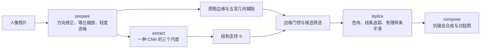

# 四种 CNN 引导的人脸漫画化

《深度学习应用》作业项目，依据 [CNN 人脸漫画生成技术路线](../../references/CNN人脸漫画生成技术路线.md)。目标是用 ResNet50、SENet、EfficientNetV2、MobileNetV3 分别提取结构，结合统一的预处理与后处理，生成可以直接比较的人像漫画。

**当前状态：项目初始化。** 已建立配置、模型候选清单、四阶段数据接口和可运行的环境检查脚本。尚未安装本项目缺失依赖、下载权重或生成四模型结果；`src/face_cartoon/contracts.py` 是接口约定，不是成图实现。

## 方法



四种模型共享画布、图像边缘、配色与笔画渲染，逐个加载、提取、释放。CNN 影响哪些边缘被保留；颜色来自照片。冻结的分类网络不直接输出漫画，方案属于“CNN 特征引导的程序化漫画化”，不训练或微调神经网络。

具体模型候选已核对发布者模型卡：

| 作业模型 | 本项目实例 | 权重来源 |
| --- | --- | --- |
| ResNet50 | `resnet50.a1_in1k` | [timm 模型卡](https://huggingface.co/timm/resnet50.a1_in1k) |
| SENet | `seresnet50.a1_in1k`，即 SE-ResNet50 | [timm 模型卡](https://huggingface.co/timm/seresnet50.a1_in1k) |
| EfficientNet v2 | `tf_efficientnetv2_s.in21k_ft_in1k` | [timm 模型卡](https://huggingface.co/timm/tf_efficientnetv2_s.in21k_ft_in1k) |
| MobileNet v3 | `mobilenetv3_large_100.ra_in1k` | [timm 模型卡](https://huggingface.co/timm/mobilenetv3_large_100.ra_in1k) |

`models.json` 的 `revision` 暂为空；首次下载时解析实际提交、记录文件哈希后再固定版本。不得把未下载的权重或随机初始化结果写成预训练模型输出。

## 目录

```text
cnn_face_cartoon/
  config.json                 启动参数与自然暖色板
  models.json                 模型候选与下载状态
  src/face_cartoon/            四阶段接口；后续核心实现放在这里
  scripts/check_env.py         检查当前解释器与依赖导入
  docs/实施计划.md              逐阶段任务、输入输出与验收
  docs/环境检查.md              本次环境快照
  data/input/                 输入照片，整个 data/ 忽略
  model/                      权重，整个目录忽略
  outputs/                    试验成图与中间缓存，整个目录忽略
  report/                     最终汇报材料，按需整理后保留
```

项目独立于已有的 `cnn_cartoon_portrait` 和 `cnn_cartoon_portrait_v2`，仅在确有需要时参考旧项目的路径追踪方法，不依赖它们的 `.deps` 或整套流程。初始阶段未复制或使用旧项目的个人照片。

## 环境检查

在本项目目录运行：

```powershell
conda activate d2l
python scripts/check_env.py
python -m ty check
```

检查脚本不安装包、不下载模型；结果写入 `.cache/environment.json`。`--strict` 会在核心依赖缺失时返回退出码 2，普通检查仍可完整输出诊断。包能导入不代表四种网络或 384 像素输入已经通过运行验证。

如果激活失败，可用绝对路径：

```powershell
& 'C:\Anaconda3\envs\d2l\python.exe' scripts/check_env.py
& 'C:\Anaconda3\envs\d2l\python.exe' -m ty check --python 'C:\Anaconda3\envs\d2l\python.exe'
```

## 后续安装

当前依赖文件是初始声明，不是验证过的版本锁。先查看解析计划，尤其确认 `torch` 与 `torchvision` 配套，避免无意改变原有环境：

```powershell
python -m pip install --dry-run -r requirements.txt
python -m pip install -r requirements.txt
python -m pip install --dry-run -r requirements-face.txt
python -m pip install -r requirements-face.txt
python -m pip check
python scripts/check_env.py --strict
```

MediaPipe 单独检查 Windows／Python 版本兼容性。关键点检测失败时允许按路线关闭几何辅助并记录原因；正式四模型成图必须使用真实预训练权重。当前先采用 CPU，待实测耗时后再决定是否处理 CUDA。

本次联合依赖解析已经通过，计划保留现有 PyTorch；这不等于实际导入／推理验证。OpenCV 统一使用 `opencv-contrib-python`，因为 MediaPipe 也依赖该包，避免同时安装两个提供 `cv2` 的版本。

## 交付目标

以 3～5 张有代表性的照片检查正脸、眼镜或轻微侧脸，必要时增加暗光照片。最终只保留三类主图：同图四模型对照、六格过程面板、原图与漫画前后对照。附一例关闭 CNN 门控的结果确认实现实际使用了 CNN。

每次运行保存 `final.png`、`comparison.png`、`process.png` 和 `run.json`；记录模型版本、输入哈希、所选层与步幅、归一化、样条偏移和实测耗时。相似结果如实展示，不用分类准确率代替漫画质量，也不构造正式人工评价指标。
