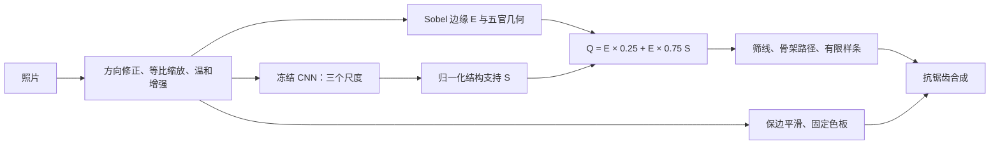

# 四种 CNN 引导的人脸漫画化

《深度学习应用》作业项目，依据 [CNN 人脸漫画生成技术路线](../../references/CNN人脸漫画生成技术路线.md)。**已完成四模型推理、颜色与笔画合成、过程可视化和离线 HTML。**

直接打开 [作业展示](outputs/assignment/index.html)，或查看 [同图四模型对照](outputs/assignment/comparison.png)。页面可以切换照片、模型，查看六格过程、结构响应和关闭 CNN 门控的对照，并保存 PNG。

## 运行

在 PowerShell 中执行：

```powershell
Set-Location 'B:\LearnSpace\Course Notes\projects\cnn_face_cartoon'
conda activate d2l

# 重现本次三张演示输入、四种模型的结果
python run.py --demo --output outputs/assignment

# 换成自己的单人照片；可以连续传入多个文件
python run.py --input 'data/input/portrait.jpg' --output outputs/my_portrait

# 对同一批输入复用已生成的缓存，只调整渲染
python run.py --input 'data/input/portrait.jpg' --output outputs/my_portrait --render-only --line-density 0.35 --palette pastel
```

`--models resnet50 senet` 可只运行部分模型；默认运行全部四种。`--no-landmarks` 关闭五官几何辅助；检测不可用或没有人脸时也会记录原因并退化为纯图像结构处理。`--line-density` 取 0～1，越大保留的候选越多。输入文件名去掉扩展名后必须互不相同。

`--render-only` 必须使用相同输入、模型与输出目录，并有匹配的预处理和 CNN 缓存；改动照片、特征参数或权重后应去掉该选项重新提取。修改色板、密度、线宽不必再次推理。一般运行也会自动复用匹配缓存。

依赖和权重已在本机验证，无需再次安装。其他环境的准备命令见 [安装与下载](docs/安装与下载.md)，当前实测版本见 [环境检查](docs/环境检查.md)。本次使用 CPU 即可完成，不要求 CUDA。

## 方法



CNN 控制边缘取舍，颜色层来自统一的照片处理。使用真实分类预训练权重，冻结全部参数；没有训练漫画解码器，因此本作业属于 **CNN 特征引导的程序化漫画化**。四模型共用画布、图像边缘、几何规则、色板和渲染参数，逐个加载和释放。

| 作业模型 | 实际权重 | 三层通道数（stride 4／8／16） |
| --- | --- | --- |
| ResNet50 | [resnet50.a1_in1k](https://huggingface.co/timm/resnet50.a1_in1k) | 256／512／1024 |
| SENet：SE-ResNet50 | [seresnet50.a1_in1k](https://huggingface.co/timm/seresnet50.a1_in1k) | 256／512／1024 |
| EfficientNetV2-S | [tf_efficientnetv2_s.in21k_ft_in1k](https://huggingface.co/timm/tf_efficientnetv2_s.in21k_ft_in1k) | 48／64／160 |
| MobileNetV3-Large | [mobilenetv3_large_100.ra_in1k](https://huggingface.co/timm/mobilenetv3_large_100.ra_in1k) | 24／40／112 |

`models.json` 已固定四个 revision；加载前验证下载清单中的 SHA256。三层按实际 `feature_info` 选择，不假设网络索引和步幅相等。公式、阈值、样条约束与实现对应关系见 [方法说明](docs/方法说明.md)。

## 本次结果

三张输入包括旧项目本地正脸照片、Matplotlib 随包公开照片，以及本地照片亮度乘 0.30 的暗光派生图；共两个人物，暗光图不是独立采集样本。所有处理在本地完成。低分辨率照片放大到工作画布不会恢复细节。

已生成 **3 张输入 × 4 种模型 = 12 组结果**。四模型颜色层逐像素相同，CNN 结构响应各不相同；关闭门控后笔画发生变化。对比中整体风格接近，差别主要在眼镜、发丝和细碎纹理。复杂背景仍有杂线，肤色色块较硬，暗光下脸部层次不足，这些局限在页面中保留。没有人工评分或模型优劣排名。

简短运行记录与结果入口见 [作业记录](report/README.md)。

## 文件

```text
run.py                       批处理入口
config.json / models.json    渲染参数与固定模型版本
src/face_cartoon/
  preprocess.py              画布、Sobel、五官几何
  features.py                冻结 CNN 与多尺度响应
  strokes.py                 非极大值抑制、骨架、样条
  rendering.py               色板、笔画、合成
  artifacts.py / cli.py      图表、HTML、缓存与运行记录
scripts/                     环境检查与模型下载
tests/                       几何和数值不变量检查
data/                        输入照片（整个目录忽略）
model/                       预训练权重（整个目录忽略）
outputs/assignment/          本次报告、成图与缓存（忽略）
report/                      不含原始照片的文字记录
```

每次输出目录保存 `index.html`、`comparison.png` 和 `run.json`。每个样例下保存预处理缓存、关闭门控对照；每个模型子目录保存 `final.png`、`process.png`、前后对照、S／E／Q 图、颜色与线条图、压缩结构缓存、路径坐标和元数据。只保存三张二维响应及 S、Q，不保存庞大的原始特征张量。

HTML 无需服务器和网络，浏览时要保留整个输出目录。分享展示时只需要 HTML、PNG 和运行 JSON；复用推理缓存时再保留 NPZ／NPY／路径数据。Git 不包含 data、model、outputs，需要展示成图时单独携带输出目录。

## 检查

```powershell
python scripts/check_env.py --strict
python scripts/download_models.py --check
python -m ty check
python -m unittest discover -s tests -v
```

已通过依赖完整性、真实四模型前向、类型检查、7 项数值与几何检查、缓存改色重绘，以及桌面／窄屏离线浏览检查。若终端没有正确激活环境，可用 `C:\Anaconda3\envs\d2l\python.exe`；ty 可显式加 `--python 'C:\Anaconda3\envs\d2l\python.exe'`。
