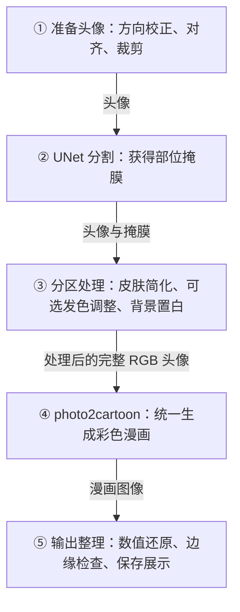

# 深度学习应用｜UNet 语义分割引导的人脸漫画生成：技术路线

<aside>
🎨

本次方案：UNet 判断人脸各部位，按部位处理照片，再由预训练 photo2cartoon 统一生成彩色漫画。

主线保持为五步：准备头像 → 语义分割 → 分区处理 → 漫画生成 → 输出整理。一次 UNet 推理、一次漫画生成，不训练或微调模型。

</aside>

整理日期：2026年11月25日。文档状态：已讨论确定的技术设计，尚未进行本次模型下载、代码实施与效果试跑。下文的效果描述是设计目标，不代表已验证结果。

**一、作业目标与方案范围**

本次作业要求：“使用 UNet 等语义分割算法，生成人脸的漫画，注意预处理和后处理。”

方案要回答三个问题：语义分割识别了什么，这些识别结果如何影响漫画生成，以及预处理和后处理分别解决什么问题。最终既要得到合理的彩色漫画，也要让人看清 UNet 在流程中的作用。

本次采用现有预训练模型，先围绕单张头像建立完整方法，不要求训练数据。摄像头、多人处理、实时性能优化和应用框架不纳入当前核心路线；需要时再接入应用层。上次使用的素描生成、五官连线和帽子合成也不直接沿用。

主功能是生成前的分区控制：皮肤简化作为主要控制项，发色调整作为可关闭的展示项，眼睛、眉毛、嘴唇等细节默认保留给漫画生成器。生成后的精细局部编辑作为有条件扩展，不成为主流程依赖。

**二、两个模型如何分工**

| 模块 | 输入 | 输出 | 本次职责 |
| --- | --- | --- | --- |
| 预训练 UNet 人脸解析 | 按模型要求适配的头像 | 每个像素的类别分数，进一步得到标签和掩膜 | 判断皮肤、头发、眼睛、眉毛、嘴唇、背景等区域 |
| 分区图像处理 | 原头像、掩膜、控制参数 | 处理后的完整 RGB 头像 | 在指定部位应用合适强度的平滑或调色 |
| 预训练 photo2cartoon | 按生成器要求适配的 RGB 头像 | 彩色漫画 | 统一生成五官、头发、线条、颜色与明暗 |

UNet 是网络结构，只有使用人脸解析任务的训练权重，才具备人脸部位识别能力。计划采用的 CelebAMask-HQ 官方 face_parsing 实现使用 UNet，输出类别数为 19，并提供训练好的模型入口。这里使用的是完成语义分割任务的模型，不能用任意名为 UNet 的图像生成网络替代。[UNet 实现](https://github.com/switchablenorms/CelebAMask-HQ/blob/master/face_parsing/unet.py) · [人脸解析说明与权重入口](https://github.com/switchablenorms/CelebAMask-HQ/blob/master/face_parsing/README.md)

photo2cartoon 的原始流程包含关键点对齐、头像裁剪、分割去背景和生成。其生成器基于 U-GAT-IT 改进，开源推理代码接收 256×256 的 RGB 头像；掩膜在生成器外围使用，并不是额外的网络输入通道。我们拟替换或扩展其原有头像分割环节，保持漫画生成器权重不变。[官方项目说明](https://github.com/minivision-ai/photo2cartoon) · [推理代码](https://github.com/minivision-ai/photo2cartoon/blob/master/test.py)

它适合作为本次第一候选，因为外围流程容易拆分与改造。但官方说明开源权重主要基于亚洲年轻女性训练，对其他人群覆盖不足；人物年龄、外观、侧脸和眼镜等情况需要在后续实施时检查。若预训练模型本身的表现不合适，优先替换漫画生成模块，保持“分割—分区处理—生成”的整体组织，不靠不断叠加滤镜补救。

**三、先理解分割与掩膜**

UNet 首先输出每个像素属于各类别的分数。对类别维度做 softmax 后得到预测概率，再取概率最大的类别，形成语义标签图。彩色分割图只是把类别编号映射成颜色，方便观察。

以 19 类、512×512 的解析画布为例，类别分数具有 19×512×512 的形状；最终标签图的形状是 512×512。具体输入尺寸和归一化遵循选定权重的官方推理约定。

掩膜（mask）是与图像位置对应的处理范围图。头发掩膜选出头发，皮肤掩膜选出皮肤。它让程序能够决定某项处理在哪些像素生效。

| 掩膜数值 | 含义 | 示例 |
| --- | --- | --- |
| 0 | 不应用这项处理 | 头发调色时，脸部保持原样 |
| 1 | 完整应用选定处理 | 头发区域采用调色结果 |
| 0～1 | 混合处理前后的结果 | 在边界做有限的柔和过渡 |

标签图中的类别编号不表示处理强度。分割概率可以帮助判断区域，但它不天然等于精细抠图的透明度，也不能单凭高概率保证预测正确。本次用明确的类别结果确定区域，再根据实际需要做有限的边界过渡，不要求发丝级抠图。

按部位处理之所以必要，是因为同一个操作对不同部位有不同影响。平滑可以减少皮肤细碎纹理，也可能模糊睫毛、眉毛和眼镜框；减少颜色层次可以形成简洁色块，也可能抹掉鼻梁阴影和眼睛高光。因此，“保护五官”是把五官排除在不适合的预处理范围之外，使有用信息仍然进入漫画模型。它不意味着生成器会原样复制五官。

**四、五步线性流程**

各阶段沿着同一条主线传递处理记录：先保存头像，再补充标签与掩膜，再保存处理后的头像和漫画结果。因此，线性流程不会丢失原图，也不意味着把彩色分割图直接送给漫画生成器。

| 阶段 | 得到什么 | 解决什么问题 |
| --- | --- | --- |
| 准备头像 | 规范头像与几何变换记录 | 人脸方向、大小和构图符合模型使用方式 |
| UNet 分割 | 部位标签、掩膜与分割可视化 | 知道各项处理应该作用在哪里 |
| 分区处理 | 经区域控制的完整 RGB 头像 | 将语义判断转化为实际图像变化 |
| 漫画生成 | 原始漫画输出 | 由已训练的生成器统一完成风格表达 |
| 输出整理 | 可显示、保存的漫画 | 正确还原图像并检查最终效果 |

**步骤 1：准备头像**

读取照片后，正确处理图片方向和颜色通道；利用人脸关键点完成旋转校正，并按 photo2cartoon 的构图方式扩展裁剪。裁剪范围应保留头发、耳朵和下巴，不能只截取检测到的紧致人脸框。

保留裁剪、旋转和缩放的变换信息，以便保证图像与掩膜的坐标一致。第一版输出规范头像，不要求贴回原照片；如果将来需要贴回，这些记录可以支持坐标恢复。

已有的检测或关键点工具可以复用，但本次作业不要求特定目标检测算法。没有检测到有效人脸时，给出明确提示，不继续对无效区域生成。

此时不进行强烈磨皮、色块量化或边缘增强。UNet 应分析正常照片，减少人为修改对分割的影响。

**步骤 2：UNet 分割与掩膜整理**

将规范头像按 UNet 权重的要求独立进行尺寸与数值适配，得到类别结果。将结果转换到统一头像坐标后，组织成皮肤、头发、五官保护和头像前景等掩膜。

标签图缩放使用最近邻插值，避免把类别编号混成新的数值；若缩放类别概率，则先插值，再决定类别或生成对应掩膜。分割与生成模型的输入尺寸可以不同，但必须来自同一头像构图。

掩膜整理只解决明显缺陷：必要时清理异常碎片、修补小孔、处理边缘锯齿。眼睛、眉毛等本来就是小区域，不能统一按面积删除。头像前景的类别组合要匹配原漫画模型的裁剪口径，不能简单合并所有非背景类别。

**步骤 3：语义引导的分区处理**

处理始终作用于保留下来的 RGB 头像。主线设定如下：

| 区域 | 处理策略 | 参数与边界 |
| --- | --- | --- |
| 皮肤 | 轻度保边平滑，减弱细碎纹理 | 以简化强度控制；保留鼻梁、脸颊等大尺度明暗 |
| 头发 | 可选的轻微颜色调整 | 尽量保留亮度、高光和阴影，不涂成纯色 |
| 眼睛、眉毛、嘴唇、眼镜 | 默认不额外修改 | 排除在皮肤平滑范围之外，保留信息给生成器 |
| 背景 | 按模型要求置白 | 使用头像前景掩膜，匹配预训练输入形式 |

皮肤平滑采用可混合的形式：

$$
I_{\mathrm{edit}}=(1-\lambda M_{\mathrm{skin}})I+\lambda M_{\mathrm{skin}}F_{\mathrm{smooth}}(I)
$$

这里，I 是规范头像，M 是皮肤处理掩膜，F 是轻度保边平滑，λ 是 0～1 的控制强度。λ 为零时关闭皮肤处理；增加 λ 时，皮肤区域逐渐采用平滑结果。该参数范围表达混合比例，不代表已经确定了效果最佳的默认值。

滤波本身也要考虑边界。即使最后仅在皮肤掩膜内写入结果，滤波过程中跨越头发、嘴唇边界取样，仍可能带来颜色污染。因此，应采用保边操作，并在敏感边界附近减弱处理，而不是简单对整图强烈模糊后裁出皮肤。

发色调整同样按掩膜混合，可在分离亮度与颜色的色彩空间中改变颜色分量，保留原有明暗变化。第一版不增加嘴唇调色、五官绘线和纹理层等控制项，避免参数过多。

处理后合并成一张完整头像，并将背景置白。不要分别生成眼睛、头发和嘴巴再拼接；完整头像一次进入生成器，更容易保持比例与画风一致。

**步骤 4：photo2cartoon 统一生成**

将处理后的头像按官方推理规范转换为 256×256 的 RGB 输入并归一化，调用预训练生成器。在推理阶段不训练模型，不运行训练中的判别器或身份损失。

生成器已经通过训练学会从照片特征重建漫画画面。其编码与解码过程共同决定线条、色彩和明暗，因此不需要额外从 UNet 提取中间特征，接入陌生的预训练解码器。

本次采用的是“分割引导输入处理”。区域选择由掩膜明确控制，而最终画面仍由生成器参与决定。调整输入发色不能保证输出精确等于指定颜色；改变局部输入也可能影响其他位置。后续展示应基于实际结果说明影响，不把该流程描述为经过联合训练的精确语义条件生成模型。

**步骤 5：输出整理与展示**

将模型输出反归一化，正确裁剪数值范围、转换颜色并保存。展示时可适当缩放，但放大显示不代表产生了更高分辨率的真实细节。

先检查边缘是否出现白边、截发或明显破损。官方推理会复用输入头像掩膜处理输出背景；我们的实现需要检查该做法与实际生成轮廓是否相容，不能默认所有输入掩膜都能直接用于漫画。主线优先保留完整的白底漫画裁剪图，避免不必要的再次抠图。

默认不叠加原照片纹理、不加素描线稿、不对全图强行锐化。生成模型已经完成画面重建，额外后处理应由实际问题驱动。

**五、必要步骤与可选步骤的取舍**

| 决策 | 操作 | 原因 |
| --- | --- | --- |
| 必需 | 方向与通道正确、对齐裁剪、各模型输入适配、输出还原 | 保证模型按预期运行 |
| 本次核心 | UNet 分割、部位掩膜、可调皮肤简化 | 让分割结果真正参与漫画生成 |
| 可选展示 | 头发轻微调色 | 展示按部位控制，可关闭 |
| 有缺陷再处理 | 掩膜碎片清理、小孔修补、局部边界过渡 | 针对问题修正，避免无差别处理破坏五官 |
| 暂不加入 | Canny、五官连线、多尺度边缘融合、额外素描叠加、样条平滑 | 当前主线没有必须使用这些方法的环节 |
| 当前不需要 | 实时跟踪、视频平滑、移动端迁移 | 本次先确定静态人像漫画方法 |

“注意预处理和后处理”不意味着必须堆叠大量算法。我们需要说明每个保留操作处理什么问题，并能够观察它带来的影响。某项处理没有收益时，应当降低强度或关闭。

**六、生成后的精细编辑作为第二步扩展**

两步安排的界限如下：

| 层次 | 技术决定 | 完成条件 |
| --- | --- | --- |
| 第一步：生成前分区控制 | 进入正式主线，一次解析、一次生成 | 从头像到漫画完整打通，分割能影响输入处理 |
| 第二步：生成后精细编辑 | 有条件扩展，不影响第一步独立完成作业 | 能可靠定位漫画中的对应部位后，再启用局部编辑 |

输入与输出尺寸相同，不意味着五官轮廓相同。photo2cartoon 可能改变眼睛和下巴等形状，所以原图细粒度掩膜不能直接照搬到漫画上。

对头发内部或大片皮肤，如果空间对应可靠，可以考虑保守的局部调色；对眼睛、嘴唇和脸部外轮廓，发生偏移时应关闭该项处理。若将来需要精确编辑漫画五官，可研究对生成图再次解析或进行几何对应，但照片上训练的 UNet 是否适应漫画，需要另外验证。第二次解析与复杂配准均不放入当前主线。

**七、展示设计与实施顺序**

最终主展示采用四张图：

| 原图 | 语义分割图 | 关闭区域控制的漫画 | 开启区域控制的漫画 |
| --- | --- | --- | --- |
| 展示输入内容 | 展示 UNet 识别的部位 | 提供相同生成流程下的默认结果 | 展示皮肤简化或发色引导的影响 |

两张漫画使用相同的裁剪、前景提取和生成器，只改变区域控制参数。这样比较的是分区处理的作用，不会混入更换模型或更换构图的差异。该展示不能单独证明 UNet 提高了所有图片的质量，但能说明它如何参与控制。

为方便排查问题，额外保存规范头像、掩膜、处理后的 RGB 头像和控制参数。它们是过程记录，不必全部放在主界面。界面只需支持图片输入、皮肤简化强度、可选发色设置、对比查看与保存；不必先做复杂应用框架。

后续实施按以下顺序推进，当前文档仅规定路线：

1. 分别跑通官方人脸解析与 photo2cartoon 推理，确认权重和输入规范正确，并记录版本及类别映射。
2. 将 UNet 掩膜接入统一头像坐标，检查背景、头发、耳朵和五官范围，再完成白底输入。
3. 接入皮肤简化与可选发色调整，保证关闭参数时能够回到相同流程的默认输入。
4. 完成输出整理与四图对比，用少量不同外观、光照、姿态的人像观察可用性。无需额外设计大规模人工评测。
5. 只有出现明确的生成后编辑需求，再进入第二步扩展；若生成模型本身不适合测试人像，先替换生成模块。

基本完成标准是：没有人脸时能正常提示；同一头像的图像与掩膜坐标一致；分割结果可观察；区域处理可以关闭和调节；能输出合理的彩色漫画；能够说明处理改变了哪里，并如实记录失败情况。

**八、作业方法的表述**

本方法使用预训练 UNet 对人脸进行语义分割，获得皮肤、头发和五官等部位掩膜。依据不同区域的特点，对皮肤进行可调强度的保边平滑，对头发提供可选的颜色调整，同时保留眼睛、眉毛和嘴唇等细节。处理后的完整头像按照预训练 photo2cartoon 的输入要求统一生成彩色漫画，最后完成输出数值还原、边缘检查与展示。通过关闭和开启区域控制的结果对比，解释语义分割如何影响漫画生成。该流程不训练或微调模型，重点是已有模型的合理组合与清楚的处理逻辑。

**参考项目与关联笔记**

- [CelebAMask-HQ 官方人脸解析说明与预训练权重入口](https://github.com/switchablenorms/CelebAMask-HQ/blob/master/face_parsing/README.md)
- [CelebAMask-HQ 的 UNet 网络实现](https://github.com/switchablenorms/CelebAMask-HQ/blob/master/face_parsing/unet.py)
- [photo2cartoon 官方项目：方法、输入规范与适用范围](https://github.com/minivision-ai/photo2cartoon)
- [photo2cartoon 官方推理代码](https://github.com/minivision-ai/photo2cartoon/blob/master/test.py)
- [多人素描与虚拟戴帽 Web：技术路线与原理解读](../../03_multiface_sketch_hat/docs/技术路线.md)
- [MyCourse 项目规范与协作约定](../../../../AGENTS.md)