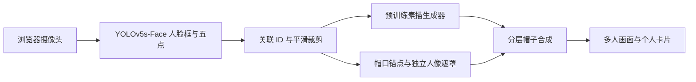

# 多人素描与虚拟戴帽

深度学习应用作业：浏览器获取摄像头画面，使用 YOLOv5s-Face 检测多人，为各人生成素描，再按头部位置、尺度和倾斜佩戴二维帽子。

**当前阶段：项目骨架与安装准备。尚未接入摄像头、加载权重或完成推理测速。**

## 路线



主线为 React + TypeScript + Vite、FastAPI 本机服务、PyTorch 推理。先比较 Informative Drawings 与 U²-Net Portrait，再选择一个主生成器。沿用原技术路线，不训练或微调，不把普通 YOLO COCO 权重当成人脸检测器。

从 [环境与模型准备](docs/环境与模型准备.md) 开始安装；[方案评审](docs/方案评审.md) 记录可行性与实施边界。原始设计位于仓库的 `references/多人素描与虚拟戴帽技术路线.md`，未修改。

## 目录

```text
backend/                 Python 服务及算法模块（待实现）
  app/                   API、检测、生成、跟踪、几何和合成的落点
frontend/                React / TypeScript / Vite 最小页面
assets/hats/             可提交的帽子素材、锚点与来源说明
config/models.json       官方模型来源与预期文件位置
scripts/                 环境、模型文件准备检查
docs/                    方案评审与安装说明
tests/                   后续几何、协议与同帧合成验证
data/input/              本地示例图和视频，整体忽略
model/                   下载的权重与压缩包，整体忽略
third_party/             官方模型源码，整体忽略
outputs/                 对照图、导出成片，整体忽略
.cache/                  环境快照和测试截图，整体忽略
```

默认用 `conda activate d2l`。`requirements.txt` 不主动替换现有 torch/torchvision；GPU 选项单独列在安装说明。前端安装后可启动初始化页，但此时没有相机和算法功能。

## 实施顺序

1. 核对依赖与三个权重：人脸检测、两种候选素描生成器。
2. 用公开示例图生成对照板，选择素描主模型；单人通过后再测 2／4 人。
3. 打通单图人脸检测、裁剪、素描、帽子定位及个人卡片。
4. 接入摄像头，完成逐人 ID、几何平滑、单帧在途和冻结拍照。
5. 增加帽子前后层与遮罩，完善多人合成和导出。

演示输入默认使用已有公开示例 `../cnn_face_cartoon/data/input/grace_hopper.jpg` 的本地副本。多人测试后续使用有来源的公开图片或生成素材；复制同一个头像只能检查多框与调度，不能证明不同人物的关联稳定性。摄像头帧与测试截图不进入文档资源目录。
