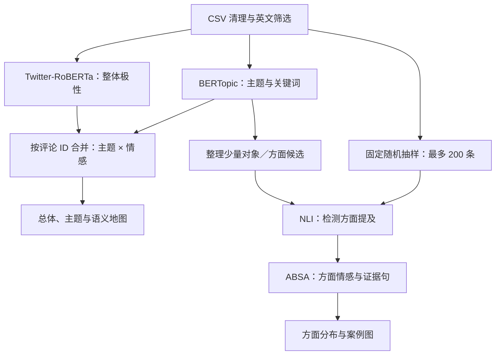

# 大数据与舆论分析｜情感探索技术路线（快速实践版）

本方案按 2026年10月26日 的课程作业要求整理，采用现成模型，重点完成从评论输入、模型推理、主题组织到可视化解释的完整流程。研究对象是一个 YouTube 视频评论区，成果定位为快速探索案例。

所属课程：《大数据与舆论分析导论》（仓库约定见 [AGENTS.md](../../../../AGENTS.md)）。

**推荐题目：基于预训练模型与 BERTopic 的中国电动车视频评论情感探索。**

本页是可执行的技术设计，尚未产生新的模型运行结果。本文中数据规模来自已读取的 CSV；主题名称、模型阈值和图表布局属于实施建议，示例不代表已经发现的结论。

## 1. 目标、范围与最终叙事

用一条清晰的叙事回答三个递进问题：

1. **总体情感：** 这个评论区的表达总体呈现怎样的正面、中性和负面分布？
2. **讨论内容：** 评论主要围绕什么话题？不同话题里的整体情感有何不同？
3. **评价指向：** 对某个具体对象的某个方面，评论表达了怎样的评价？

## 2. 数据准备与分析边界

已确认的原始数据情况：

| 项目 | 已读取结果 | 本次处理 |
| --- | --- | --- |
| 记录与来源 | 1,196 条，来自同一视频 | 只讨论本评论区，不外推公众总体 |
| 作者 | 855 个不同作者标识 | 主分析单位是评论，不称为人数 |
| 记录类型 | 699 条主评论、497 条回复 | 保留 type，供悬停与案例说明 |
| 文本缺失 | 无缺失或纯空白评论 | 代码仍保留缺失检查 |
| 重复文本 | 两组相同文本，出现在不同记录类型中 | 保留记录，增加 duplicate_group；不直接认定为采集错误 |
| 语言 | 36 条含汉字，抽样确认有中文与混合语言 | 先划出英文主分析子集；不把“无汉字”等同于英文 |
| 时间与回复关系 | 无时间戳、无父评论 ID | 不画时间趋势，不重建回复链 |
| 视频字段 | videoID 全空，pageUrl 有值 | 来源用 pageUrl 标识，不把 videoID 作为关联键 |
| 点赞 | 最高 10 条占总点赞约 54.3% | 核心图按评论计数；点赞只作案例补充 |

为每条原始记录创建稳定的 comment_id，例如原始行号加固定前缀。先创建 ID，再过滤、排序和抽样，避免不同阶段结果错位。

保留三个文本字段：

- **text_raw：** 原始文本，用于引用与追溯。
- **text_model：** 轻量清理后的模型输入。统一空白，按模型需要把用户名、链接变成占位符，保留否定、标点和表情。
- **text_topic：** 主题分析文本。去掉用户名和链接噪声，保留语义内容；英文停用词在关键词统计阶段处理，不对情感输入做同样删词。

英文筛选可以调用现成语言检测器，再快速检查短文本、表情和混合语言等不确定项。无法确定的文本标记为待定，不强制归入英文。最终记录 original_count、english_count、excluded_count，所有核心图采用同一英文子集。

这一版不增加机器翻译或多语言情感模型，以控制复杂度。中文及其他语言保存在原表中，报告说明其未纳入英文模型统计即可。

## 3. 各方法如何串联

整体极性与主题标签分别从同一批文本得到，再按 comment_id 合并。主题标签不需要输入 RoBERTa，RoBERTa 的三个 logits 也不用于主题聚类。



这条流程包含几种模型，但它们各自承担不同任务，组成串联分析；没有并行比较多个整体情感模型。

## 4. 整体极性：Twitter-RoBERTa

使用检查点：

```
cardiffnlp/twitter-roberta-base-sentiment-latest
```

它针对英文社交媒体文本，输出 negative、neutral、positive 三类。模型发布者提供了标签映射与用户名、链接的预处理示例，实施时按实际模型配置读取标签名称。[模型卡](https://huggingface.co/cardiffnlp/twitter-roberta-base-sentiment-latest)

计算过程是：

$$
x \xrightarrow{\text{Tokenizer}} \text{IDs}
\xrightarrow{\text{Transformer}} h
\xrightarrow{\text{Classification Head}} z
\xrightarrow{\text{Softmax}} p
$$

$$
p_k=\frac{\exp(z_k)}{\sum_j\exp(z_j)},\qquad
\hat y=\arg\max_k p_k
$$

保存三个类别概率、最大概率及对应标签。辅助情感分数定义为：

$$
s_i=p_i(\mathrm{positive})-p_i(\mathrm{negative})
$$

这个分数用于排序、配色和汇总，表示模型的正负倾向；不称为真实心理强度。最大概率是模型置信度，不是已验证的正确率。

**建议启动设置：** CPU batch_size=8，GPU batch_size=32；max_length=512，并检查 tokenizer 和模型允许长度。统计被截断评论的数量；第一版不额外设计长文本分块加权。设置 model.eval()，使用 torch.inference_mode()，避免无用的梯度计算。

```python
inputs = tokenizer(
    batch_texts, padding=True, truncation=True,
    max_length=512, return_tensors="pt"
).to(device)

with torch.inference_mode():
    logits = model(**inputs).logits
    probs = torch.softmax(logits, dim=-1)

# 从 model.config.id2label 确认类别顺序，再保存三类概率。
```

这是核心步骤示意，依赖已初始化的 tokenizer、model、device 和 batch_texts，不是独立完整程序。

调用失败的记录保存 status="failed"，不能用“中性”填补。预测成功但把握较低的评论可以加标记，仍与真正的中性类别区分。

## 5. BERTopic：主题为何有用，以及关键词如何产生

### 5.1 主题在情感分析中的作用

主题为整体情感增加“讨论内容”这一维度。只看总体分布，只能描述多少条评论被判为负面；加上主题后，可以观察负面表达主要出现在哪些讨论中，并找到值得细读的代表评论。

例如，某组评论围绕价格，另一组围绕进口政策。两组都可能包含大量负面表达，但前者可能在抱怨现有汽车太贵，后者可能在批评贸易限制。主题让我们看见这些内容差别，避免把所有负面表达混成一个解释。

**本方案中，主题分析不修改情感预测，也不自动提高分类准确率。它用于分组、解释、选取案例，并帮助整理后续方面候选。**

主题与情感合并后计算：

$$
N_{t,k}=\#\{i:\mathrm{topic}_i=t,\ \mathrm{sentiment}_i=k\}
$$

$$
r_{t,k}=\frac{N_{t,k}}{\sum_j N_{t,j}}
$$

r 表示“某主题内各类整体情感的占比”。它不能直接解释为“对该主题对象的支持率”。例如，进口政策主题中的负面评论可能在反对限制政策，也可能在反对进口；要进一步判断评价指向，需要方面／对象分析。

### 5.2 BERTopic 的处理链

使用下列组合：

| 环节 | 组件 | 输出 |
| --- | --- | --- |
| 文本语义表示 | SentenceTransformer：all-MiniLM-L6-v2 | 每条英文评论的语义向量 |
| 聚类前降维 | UMAP | 适合后续聚类的低维表示 |
| 主题聚类 | HDBSCAN | topic_id；无法稳定归类的记录标为 -1 |
| 词与短语统计 | CountVectorizer | 主题内的候选词和双词短语 |
| 主题关键词权重 | c-TF-IDF | 能区分各主题的关键词 |
| 语义重排 | KeyBERTInspired | 与主题代表文本更接近的候选关键词 |

这是 BERTopic 的模块化流程；主题拟合需要运行降维与聚类，但不会更新本方案中 Transformer 的权重。因此，它符合“不训练／微调神经网络”的作业范围。[算法说明](https://maartengr.github.io/BERTopic/algorithm/algorithm.html)

all-MiniLM-L6-v2 是预训练句向量模型，可用于聚类；此处不拿情感分类 logits 充当语义向量。[句向量模型](https://huggingface.co/sentence-transformers/all-MiniLM-L6-v2)

### 5.3 能否生成“语义主题关键词”？

**可以输出结合语义信息的主题关键词，但应区分三个层次。**

| 输出 | 形成方式 | 本次是否使用 |
| --- | --- | --- |
| 主题簇 | 根据评论向量相似性聚类 | 使用 |
| 代表关键词／短语 | c-TF-IDF 选取，KeyBERTInspired 进行语义重排 | 使用 |
| 可读主题标题 | 根据关键词和代表评论概括 | 人工/llm简短命名 |

c-TF-IDF 把同一主题的文本合并成一组，强调在这一组中具有代表性、能与其他组区分的词。它主要是统计权重，并不等于语言模型生成摘要。[c-TF-IDF 说明](https://maartengr.github.io/BERTopic/getting_started/ctfidf/ctfidf.html)

KeyBERTInspired 利用主题代表文本的向量与候选词／短语向量之间的相似性改善关键词选择。它增强了关键词的语义代表性，但仍以候选词为基础，不会自动保证生成抽象、流畅的主题标题。文档中的 representation “fine-tuning”在这里是改善主题表示，不是训练模型权重。[KeyBERTInspired 说明](https://maartengr.github.io/BERTopic/getting_started/representation/representation.html#keybertinspired)

举例说，某主题可能得到 tariff、import、free market 等词，然后人工/llm命名为“关税与市场准入”。

### 5.4 推荐启动参数

下面是一次快速尝试的起点，不是经过优化的最佳参数：

| 配置项 | 启动值 | 用途 |
| --- | --- | --- |
| UMAP n_neighbors | 15 | 建立局部邻域 |
| UMAP n_components | 5 | 用于聚类，不是最终展示坐标 |
| UMAP min_dist / metric | 0.0 / cosine | 语义向量降维 |
| UMAP random_state | 42 | 尽量稳定展示 |
| HDBSCAN min_cluster_size | 20 | 避免过小主题 |
| HDBSCAN min_samples | 5 | 初始密度要求 |
| CountVectorizer | stop_words="english", ngram_range=(1, 2), min_df=1 | 提取词与双词短语；小主题数时避免过度过滤 |
| ClassTfidfTransformer | 默认配置 | 生成初始主题词权重 |
| representation_model | KeyBERTInspired() | 语义关键词重排 |
| top_n_words | 8 | 每个主题保留少量解释词 |
| nr_topics | None | 第一遍不强制固定主题数量 |

先跑一遍，检查各主题的关键词、规模与两三条代表评论。若主题明显过碎或过粗，只做一轮小范围参数调整，记录改了什么，不做网格搜索。

不要为了凑图硬造 6 个主题，也不要把 -1 全部强行分配到已有主题。若几乎全部是 -1，先检查文本、语言和聚类参数；若确实无法得到清晰主题，就如实说明探索结果。

通过 get_topic_info()、get_topic(topic_id)、get_representative_docs(topic_id) 提取规模、关键词和代表文本。人工命名后保留 topic_id，避免主题名称变化影响表关联。

KeyBERTInspired 输出的关键词分数与 c-TF-IDF 权重含义不同；字段记录 keyword_score 和 keyword_score_type，不能把它们都写成“出现次数”或“主题概率”。

## 6. 深度学习方面级分析：提及检测与情感分类分开

### 6.1 本次采用的范围

从纳入分析的英文评论中固定随机抽取最多 200 条，random_state=42，保存抽样 ID。主图明确标注“方面分析子样本 n=实际数量”。主题情感统计使用全量英文子集，方面情感统计使用抽样子集，二者不能混用分母。

结合 BERTopic 关键词和代表评论，整理约 4～6 个对象／方面组合。初始候选可以如下，运行主题分析后允许删除不适用项：

| 候选组合 | 英文方面输入示例 | 自然语言提及描述示例 |
| --- | --- | --- |
| 中国电动车的价格 | price of Chinese electric vehicles | This sentence discusses the price or affordability of Chinese electric vehicles. |
| 中国电动车的质量 | quality of Chinese electric vehicles | This sentence discusses the quality or reliability of Chinese electric vehicles. |
| 中国电动车的安全 | safety of Chinese electric vehicles | This sentence discusses the safety or privacy risks of Chinese electric vehicles. |
| 中国电动车的技术 | technology of Chinese electric vehicles | This sentence discusses the technology or features of Chinese electric vehicles. |
| 美国限制进口的政策 | US restrictions on Chinese electric vehicles | This sentence discusses US restrictions or tariffs on Chinese electric vehicles. |
| 美国汽车企业的竞争力 | competitiveness of US automakers | This sentence discusses the competitiveness of US automakers. |

这些类别是快速探索的分析框架，尚不是数据统计结果。候选中要写明对象，避免把“美国汽车太贵”的评价归给“中国电动车价格”。

主题可以帮助设计候选，但不限制每条评论只能检测所属主题的方面；一条评论可能包含多个方面。

### 6.2 第一步：NLI 检测是否提及

使用 facebook/bart-large-mnli，把方面描述作为待判断的假设，判断句子是否支持该描述。它是预训练自然语言推断模型，可以用于零样本分类；多标签设置允许多个方面同时成立。[模型说明](https://huggingface.co/facebook/bart-large-mnli)

评论先切成句子；可用 spaCy 的空白英文管线加 sentencizer，不需要下载完整的 Transformer 句法模型。保留 comment_id、sentence_id 和完整原文，便于回看指代关系。

```python
detector = pipeline(
    "zero-shot-classification",
    model="facebook/bart-large-mnli",
    device=device_index,
)

result = detector(
    sentence,
    candidate_labels=aspect_hypotheses,
    hypothesis_template="{}",
    multi_label=True,
)
```

这里的候选是完整英文描述，所以把 hypothesis_template 设成 "{}"，避免套用默认模板后形成不自然的句子。

启动阈值可设为 0.60：达到阈值的组合进入下一步，其他组合标记为未检测到。这个阈值只是快速探索设置，不是校准后的可靠概率界线。用约 5～10 条句子检查是否出现“什么方面都被选中”或“什么都选不中”，必要时做一次调整并记录。

如果句子只有 “they are terrible” 之类的指代，无法明确对应对象，可保留 context_needed 标记，不凭空补出评价对象。句子很长需要截断时，也要保留标记。

**方面提及检测分数与情感分类置信度分开存储。未提及不是中性。**

### 6.3 第二步：对已检测方面调用 ABSA

使用：

```
yangheng/deberta-v3-base-absa-v1.1
```

它在这里负责“给定文本和方面，预测情感”，不承担自动判断方面是否存在。按照模型接口将原句与英文方面短语作为文本对输入。[模型接口](https://huggingface.co/yangheng/deberta-v3-base-absa-v1.1)

```python
inputs = absa_tokenizer(
    sentence,
    text_pair=aspect_text,
    return_tensors="pt",
    truncation=True,
    max_length=256,
    padding=True,
).to(device)

with torch.inference_mode():
    logits = absa_model(**inputs).logits
    probs = torch.softmax(logits, dim=-1)
```

读取模型配置中的标签顺序；若配置只有通用 LABEL_0 等名称，按发布者说明确认，不猜测。保存三类概率、标签、mention_score、完整证据句。

不用手工拼接字面量 "[SEP]"；使用 tokenizer 的文本对接口。不要让模型对全部候选直接输出情感后，再用高置信度证明“方面被提及”。

商品评论 ABSA 模型对政策、讽刺和多对象表达可能不稳定。因此政策类输出只作为探索结果，展示原句，不把情感标签改写成支持／反对的立场标签。

### 6.4 聚合成评论—方面记录

保留句子级明细，再生成 comment_id × aspect_id 的唯一记录供图表统计：

- 同一评论对同一方面只出现一种方向，保留该方向。
- 正面和负面同时出现，标为“混合”；它是句子结果的聚合标记，不是模型新增类别。
- 正面与中性同时出现、但无负面，聚合为正面；负面与中性同理。
- 全部是中性，才聚合为中性。
- 未检测到的方面不进入方面情感分母，另统计无方面匹配的评论数量。
- 仅有失败推理的组合标记 failed，不伪装成中性。

这样一条长评论不会因为重复说三次价格而在价格图中计三票，也不会把同一评论的整句分数复制到所有方面。

## 7. 结果表与关联方式

所有表都保留 comment_id；主题名称和文本内容都不能代替稳定 ID。

| 表 | 一行代表什么 | 主要字段 |
| --- | --- | --- |
| comments_analysis.csv | 一条原始评论记录 | comment_id、text_raw、text_model、language、included、type、voteCount、duplicate_group、三类概率、sentiment_label、sentiment_score、topic_id、topic_name、status |
| topics_summary.csv | 一个主题 | topic_id、topic_name、comment_count、keywords、keyword_score_type、正中负计数与比例、representative_ids |
| aspect_evidence.csv | 一个句子里的一个被检测方面 | comment_id、sentence_id、aspect_id、target、aspect、evidence、mention_score、三类概率、sentiment_label、status |
| aspect_summary.csv | 一个对象／方面组合 | aspect_id、sample_comment_count、mentioned_comment_count、正中负混合计数与比例 |
| run_config.json | 一次运行设置 | 模型 ID 与实际 revision、包版本、随机种子、语言范围、抽样 ID、阈值、截断数量、各阶段成功／失败数 |

最终绘图从这些结果表读取，不在绘图时重新调用模型。Notebook 重跑图表不会重新下载和推理全部模型。

## 8. 最终可视化：六张主图和一个案例区

整体采用“全局 → 内容分组 → 语义关系 → 具体评价对象”的阅读顺序。所有百分比旁边注明分母；没有数据的单元格显示“无记录”，与真实的 0% 区分。

| 图 | 具体表示 | 数据口径 | 希望读者理解什么 |
| --- | --- | --- | --- |
| 图 1：整体极性 | 正面、中性、负面水平条形图；标数量和百分比 | 全部英文评论中整体情感预测成功的记录 | 评论表达的总体分布 |
| 图 2：主题概览 | 按规模降序的横向条形；旁边列出各主题 3～5 个关键词 | 全部完成主题分析的英文评论；-1 单独列为未归类 | 大家在谈什么 |
| 图 3：主题内情感 | 每个主题一条 100% 堆叠横条，右侧标 n | 各主题内有有效情感预测的评论 | 不同话题里的情感组成 |
| 图 4：评论语义地图 | 固定同一组二维 UMAP 坐标，支持切换主题色／情感色；悬停看原文 | 与主分析一致的英文评论；失败情感显示灰色状态 | 相似内容如何聚集，情感在语义空间如何分布 |
| 图 5：对象／方面情感 | 按提及评论数降序的 100% 堆叠横条，包含混合；右侧标 n | 200 条以内子样本的唯一 comment_id × aspect_id 记录 | 对哪些对象的哪些方面出现不同评价 |
| 图 6：案例证据 | 3～5 条评论的原文、整体标签、主题词、方面结果并列 | 从真实运行结果选取，标明是示例 | 为什么整句情感与对象评价需要分开 |

图 4 的聚类来自前面的五维 UMAP 与 HDBSCAN；二维 UMAP 仅用于展示，不在二维地图上重新分簇。两个配色视图使用相同坐标，便于比较。不要把图上两团相距较远解读成严格的语义距离结论。

图 5 的 n 是该方面被提及且有有效情感结果的独立评论数，不是总方面记录数。多方面评论可以同时出现在不同方面中，所以各方面计数相加可能超过抽样评论数；同一方面内只计一次。

案例区优先选择三种情形：整体情绪与方面结果基本一致；一句话对不同对象褒贬不同；短回复或讽刺表达难以解释。展示不确定案例即可，不组织正式误差率评估。

### 8.1 视觉样式

- 背景白色或浅灰，深灰正文，清晰的中文字体；中文标题、英文原句和关键词并存。
- 情感颜色统一：正面青绿 #238B8E，中性灰 #9CA3AF，负面橙红 #D76A4A，混合紫 #8B6BB1。标签和顺序始终一致。
- 主题采用另一套离散配色，未归类主题用浅灰；不要把某个主题固定染成负面色。
- 图宽、标题字号和边距统一；不用 3D 饼图、密集词云和装饰性仪表盘。
- 图 2 的关键词直接显示在条形旁或单独的小卡片中，比单独词云更容易比较。
- Plotly 用于交互地图和悬停；Matplotlib／Seaborn 用于报告静态图。静态图导出 300 dpi PNG，必要时另存 SVG。
- Plotly 可保存自包含 HTML；静态导出若依赖 Kaleido/浏览器环境不顺畅，直接用 Matplotlib 重画关键图，不让导出依赖阻塞作业。
- 不制作时间趋势或用户关系网络，因为原数据没有对应字段。

主图旁的说明应使用“模型预测的负面表达比例”“某主题内的评论情感分布”等准确措辞，不把结果写成“公众反对率”。

## 9. 实现顺序

| 单元组 | 主要工作 | 本阶段完成标志 |
| --- | --- | --- |
| 01 配置与环境 | 路径、模型名、device、seed、样式 | CPU/GPU 检测正常，配置集中可修改 |
| 02 数据准备 | 读取、ID、语言筛选、轻量清理 | 打印原始／纳入／排除数量，保留原文 |
| 03 整体极性 | RoBERTa 批量推理并缓存 | 每条有效评论有三类概率或明确失败状态 |
| 04 主题发现 | 句向量、BERTopic、关键词与标题 | 输出主题清单和代表评论 |
| 05 主题与情感合并 | 按 comment_id 关联和统计 | 图 1～3 可以生成 |
| 06 语义地图 | 从缓存向量计算二维展示坐标 | 图 4 可切换主题／情感颜色 |
| 07 方面提及检测 | 固定抽样、切句、NLI 过滤 | 保存被提及方面与证据句 |
| 08 方面情感 | ABSA 文本对推理、按评论聚合 | 图 5 和案例结果可生成 |
| 09 导出与叙事 | 保存表、图和配置，写简短解释 | 每张图有明确样本范围和对应说明 |

推荐 Python 依赖：pandas、numpy、torch、transformers、sentence-transformers、bertopic、umap-learn、hdbscan、scikit-learn、matplotlib、seaborn、plotly、tqdm；方面切句可用 spaCy 空白管线，语言检测使用一个现成工具即可。

先用小批文本测试模型加载和字段结构，再运行全量。模型依次加载；内存或显存紧张时先缓存上一阶段结果，再释放该模型。ABSA 的 200 条随机子样本固定，不用“前 200 条”替代。

## 10. 最低检查与异常处理

为了快速完成，只保留下面这些检查：

1. **数量对应：** comment_id 唯一，按 ID 合并后不丢行、不重复膨胀；方面表允许一条评论多方面，但汇总前对评论—方面去重。
2. **模型输出：** 三类情感概率每行约等于 1；失败结果与中性分开；NLI 多标签分数不要求跨方面求和为 1。
3. **主题可读：** 看每个主要主题的关键词和两三条代表评论，确认标题没有脱离内容；保留未归类比例。
4. **方面逻辑：** 用少量句子确认未提及的方面不会普遍出现，同一句话不同方面可以得到不同结果。
5. **图表一致：** 样本量、计数、占比、颜色与正文一致；ABSA 子样本与全量图明确区分。

不需要制作混淆矩阵、F1 排行榜、显著性检验或大规模人工标注。未评估准确率就不报告准确率，也不把置信度当作它的替代品。

如果某个模型无法下载或推理失败，保留已经完成的前序结果，并说明未完成环节。不要静默换成词典规则后仍标成深度学习输出。主题数太少时直接展示实际主题；方面样本太少时显示计数与案例，不勉强作比例比较。

## 11. 报告写作与完成标准

报告按下面顺序展开：

1. 说明研究对象、数据来源、语言范围与本次快速探索目的。
2. 用方法流程图介绍各阶段如何衔接，强调预训练模型推理与 BERTopic 无监督拟合的区别。
3. 展示整体极性分布，描述模型观察到的总体表达倾向。
4. 展示主题关键词与规模，再比较各主题内的情感组成。
5. 用语义地图连接内容相似性与情感分布。
6. 展示抽样方面分析，结合证据句说明整体负面不等于对中国车持负面评价。
7. 用一小段说明单视频、英文子集、回复上下文缺失和模型误判等实际边界。

结论只写本次实际运行支持的发现。可以说“在纳入的英文评论中，模型将某类表达判为……”“某主题内负面表达较多”；不根据标题、国别词或作者昵称推断评论者身份，也不把这些情感结果换算成政治立场。

**完成标准：** 一个能从头运行的 Notebook；一张统一评论结果表；主题及方面明细；六张主图／案例图；一个交互语义地图；一份记录模型与参数的配置；几段围绕实际图表的解释。方案不要求训练模型、不要求多方法对照、不要求正式性能评估。

## 12. 官方资料与本方案依据

- [Twitter-RoBERTa：模型、标签与预处理](https://huggingface.co/cardiffnlp/twitter-roberta-base-sentiment-latest)
- [Sentence Transformer all-MiniLM-L6-v2](https://huggingface.co/sentence-transformers/all-MiniLM-L6-v2)
- [BERTopic 算法与组件](https://maartengr.github.io/BERTopic/algorithm/algorithm.html)
- [BERTopic c-TF-IDF](https://maartengr.github.io/BERTopic/getting_started/ctfidf/ctfidf.html)
- [BERTopic KeyBERTInspired 表示](https://maartengr.github.io/BERTopic/getting_started/representation/representation.html#keybertinspired)
- [BART-MNLI 零样本分类](https://huggingface.co/facebook/bart-large-mnli)
- [DeBERTa ABSA 模型](https://huggingface.co/yangheng/deberta-v3-base-absa-v1.1)

数据规模来自本次读取的原始 CSV；模型功能与接口依据上述发布者资料；启动参数、抽样量、聚合规则和视觉方案是为本次作业设计的实施选择。
