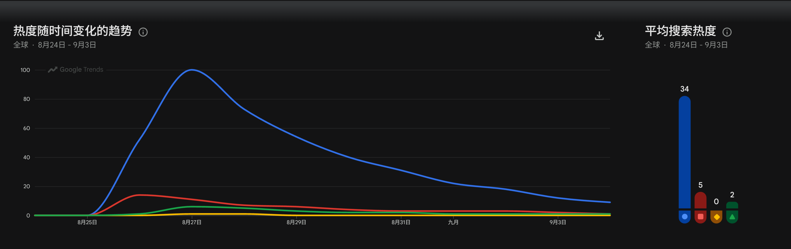
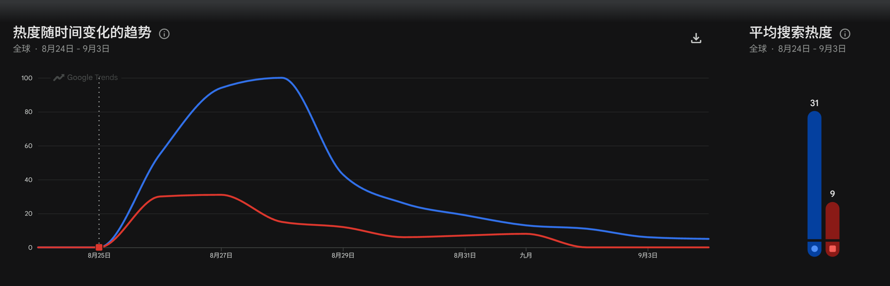
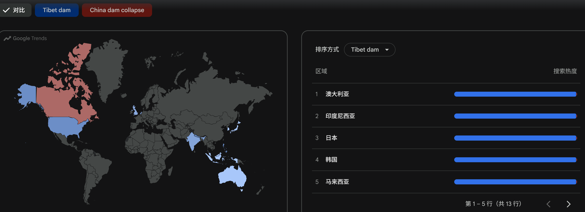
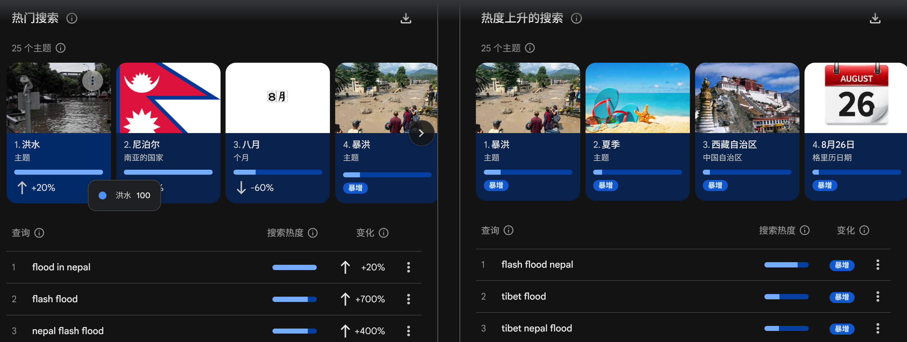

# 02｜数据架构与预处理口径

## 为什么采用三层互补的数据架构

单靠某一个平台的数据，很难同时看清“舆论何时爆发、主流媒体何时跟进、公众究竟在搜什么”。因此，本次实践围绕物理起动零点 $t_0$（`2026-08-26 02:52:10 UTC`）设计了三层互补的轻量采集架构，在不依赖昂贵商业接口的前提下，控制在 1–2 天的工作量内完成闭环。

第一层是 **X 平台带精确时间戳的定向核心样本**，用于观测灾后 0–72 小时内部的精细叙事切换与账号互动。由于官方免费接口无法回溯历史推文，我们设计了带严格反幻觉约束的 JSON Schema（完整提示词见 [附录-Grok_X数据采集任务单.md](附录-Grok_X数据采集任务单.md)），委派 Grok 按“谣言与早期扩散（Batch 1，32 条，`X01–X32`）”和“官方、科学与辟谣（Batch 2，22 条，`X33–X54`）”两批定额检索，最终合并为 `data/raw/grok_x_posts.json`（54 条唯一 URL、40 个唯一账号，累计约 4,283 万浏览量，精确覆盖 $+1.64\text{h}$ 至 $+63.85\text{h}$）。需要明确的是，该样本属**定额定向抽样（purposive quota sample）**而非全站随机抽样，因此其统计占比与曝光对比应解释为“核心高影响力代表集内的结构与头部落差演示”，而全平台客观趋势则交由 GDELT 全目录切片与 Google Trends 共同印证。

第二层是 **GDELT 全球新闻目录切片**，作为主流媒体信息供给的外部参照。沿用此前项目的工程经验，采集脚本 `collect_gdelt.py` 优先尝试 GDELT DOC 2.0 接口，并在连续遭遇两次 `HTTP 429` 限流后自动熔断，无缝切换至无频控的 Web NGrams TOC 静态存储桶，按每 6 小时抽取 14 个目录切片（13/14 成功），从 24,131 条全球新闻目录中筛选出 220 篇本次灾害相关报道。

第三层是 **Google Trends 宏观搜索基线与地域分布**。具体导出操作如下：
1. 打开 [Google Trends 探索页](https://trends.google.com/trends/explore)，地区选 **全球（Worldwide）**，时间范围自定义 **`2026-08-24` 至 `2026-09-04`**（含灾前 2 天零基线），类别与类型保持“所有类别 / 网页搜索”。
2. 第一组添加 4 个主事件对比词：`Nepal flood`（灾害总关注）、`Rasuwa`（核心受灾地名）、`Tibet dam`（溃坝谣言追问）、`glacier collapse`（自然成因搜索），导出 `google_trends.csv`（12 天日粒度）与 `by_region.csv`（43 国/地区相对占比）。
3. 由于主词 `Nepal flood` 搜索总量极大、会压扁细词曲线，单独再检索第二组溃坝双词 `Tibet dam` + `China dam collapse`，导出 `google_trends_dam.csv`（12 天）与 `by_region_dam.csv`（13 国/地区相对占比）。

原始检索界面与地域热力对照（直接复用 `report/figures/` 归档图）：

## 双层布尔检索与关键词核读的教训

在 GDELT 全球新闻筛选中，我们采用统一的双层布尔逻辑 $Q_k = B \cap T_k$：先用基础事件词 $B$ 锁定中尼边境地名与洪灾/泥石流词，再分别与溃坝谣言簇 $T_1$、地震误读簇 $T_2$、冰川崩塌科学簇 $T_3$ 和权威机构供给簇 $T_4$ 求交集。

对命中标题的逐条人工核读，带来了一个很值得记取的方法教训。在 220 篇命中报道里，有 15 篇标题直接点出冰川或冰岩崩塌，而命中 `dam` 词的仅有 2 篇：其中一篇 8 月 28 日的印地语报道确实受到社媒外溢影响，误引了福建永安水电站视频来质疑中国水电；另一篇英文报道标题写的是 *“Nepal faces secondary flash flood risk as debris creates temporary dam”*，这里的 `dam` 指的是泥石流堵江形成的自然堰塞坝，与“中国大坝溃坝”毫无关系。可见，自动布尔匹配只能用于快速定位候选，绝不能跳过核读直接把关键词命中数当作谣言计数。

## 六项确定性预处理规则

大模型在辅助检索时能高效提供逐字原文和精确时间戳，但自动生成的分类字段仍需人工复核与确定性脚本清洗。在 `analyze.py` 中，我们对原始只读文件保留完整 SHA-256 哈希，并执行六项透明清洗：

- **时间轴校准与分阶段**：统一计算每条帖文距 $t_0$ 的相对小时数 `hours_since_t0`，按 6 小时分箱，并将全周期划分为 `0–24h 信息真空期`、`24–48h 核实对冲期` 与 `48–72h 二次谣言与澄清期`。
- **立场字段人工复核与留痕**：保留原始列 `claimed_cause_raw` 不做覆盖，新增审核列 `narrative_stance` 划分 6 类互斥立场。对 6 条明显归类偏差做逐条纠偏并写明理由：例如 `X06`（指责中国喜马拉雅基建引发雪崩）与 `X24`（转进指责中国晚通报 45 分钟）原先被宽泛标为 `glacier_rock_collapse`，与 `X12 / X13 / X28 / X31` 一同统一归入 `geopolitical_blame_other`（基建与预警延误衍生归责）。
- **白盒话术与视频指纹重提取**：原始 `reused_slots` 混入了 `Tibet / Rasuwa` 等通用地名，且对辟谣引述帖也打上了 `"Chinese dam"` 标签。清洗阶段改用确定性正则重新提取 8 类核心特征槽位（大坝溃坝词、`reportedly` 免责词、`291` 外籍、`105` 印度人、美籍夸大数字、延迟预警指控、`M4.4/5.2` 地震词、以及精确到毫秒的 **`67584 ms` 同源监控视频指纹**）。
- **互动网络去噪**：显式传播图自动剔除 `X02`（`@ferozwala`）的自引用环，将跨账号 `quote / reply` 与正文 `@mention` 分层记录；构建暗线共现网时，明确排除科学解释与辟谣帖，防止“引用谣言以驳斥谣言”的账号被误判为同伙。
- **多语种标定**：按字符集自动标出英语（44 条）、尼泊尔语（9 条，主要为官方应急与卫星定性通报）和意大利语（1 条跨语种转引），为量化“跨语种信息真空”提供依据。
- **保留原始异常物证**：对 `X11`（`@Ujwalthapa12`）截断在半截词上的原文（`"& 1 . of a Chinese dam in Tibe"`）保持原样不修补，使其成为机械复制搬运的直接证据。
