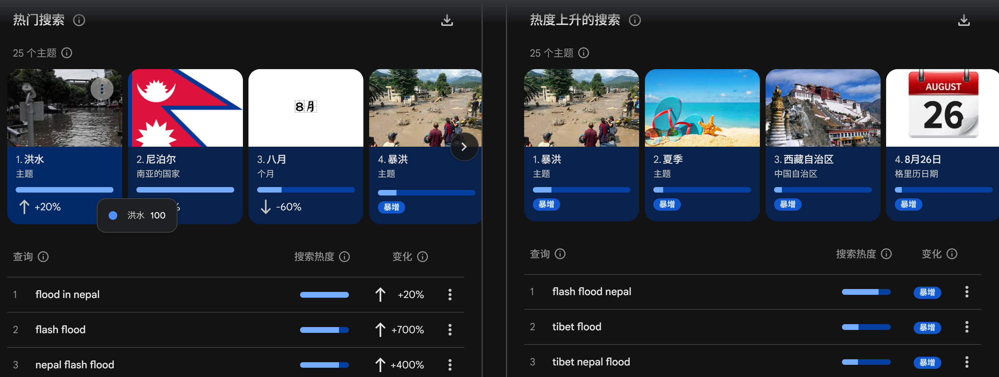
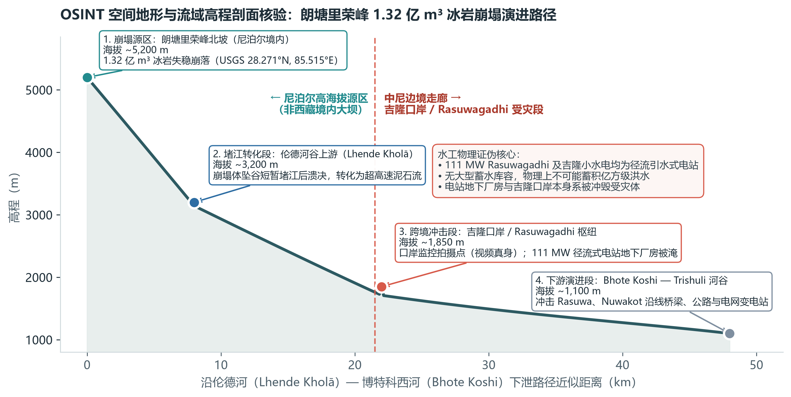
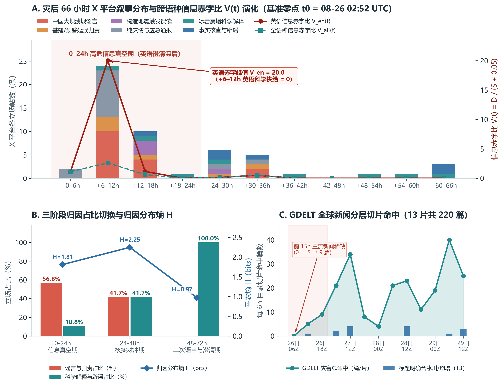
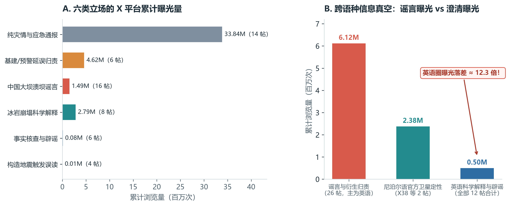
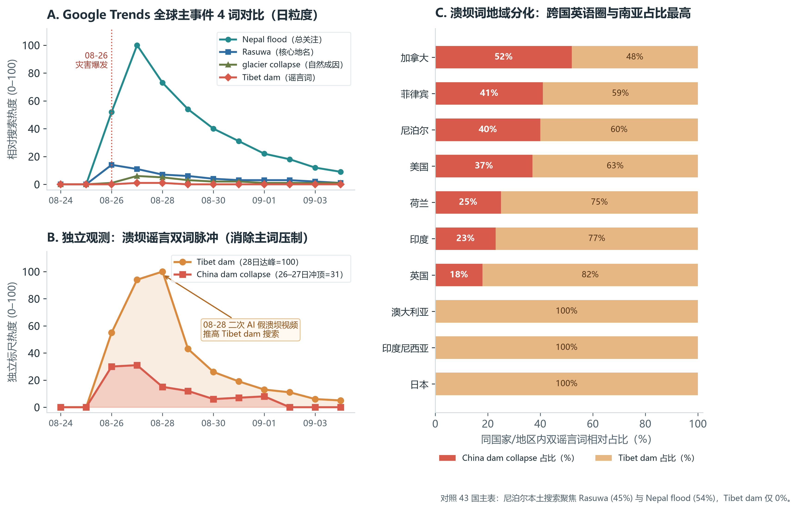
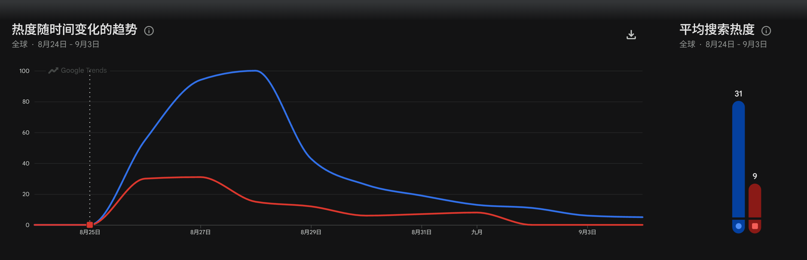
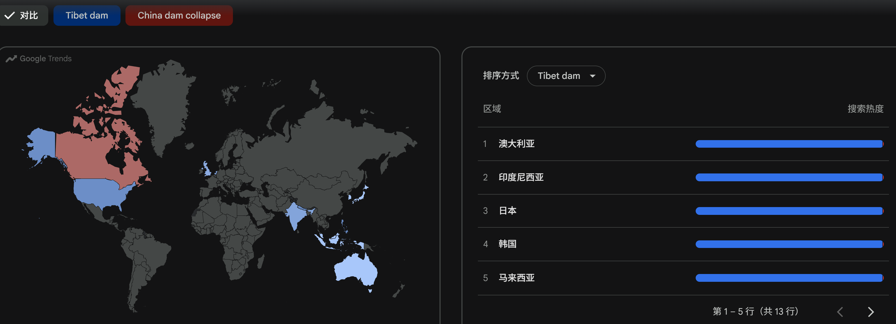
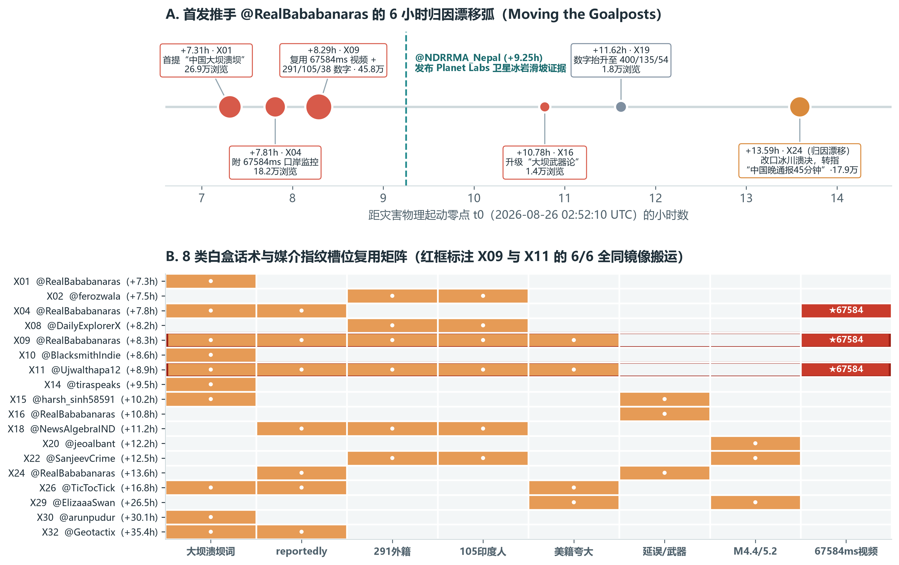
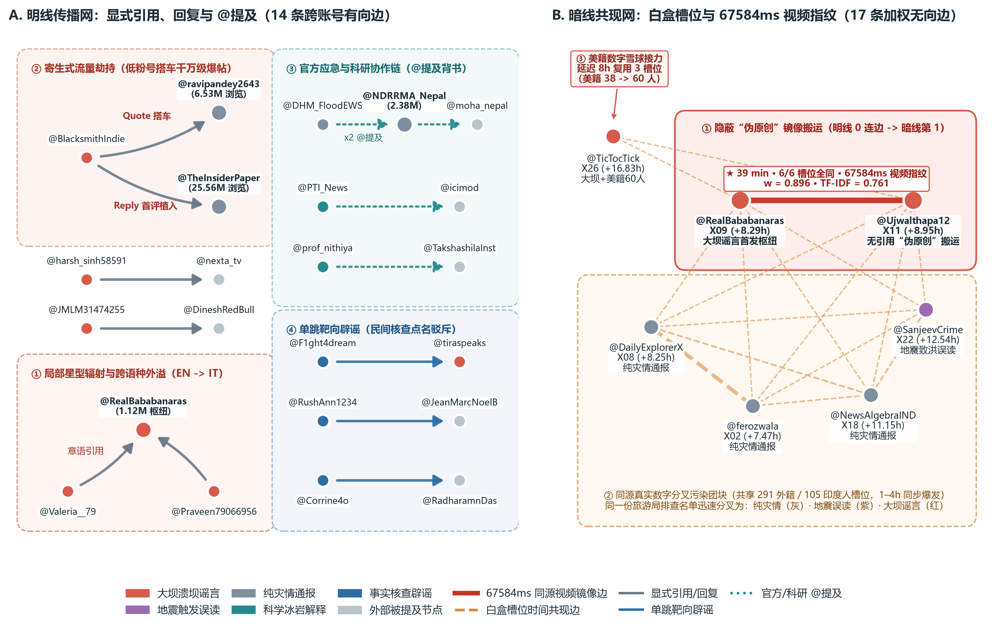

# 2026 年中尼边境泥石流灾害“西藏大坝溃坝”谣言：事实核查与 72 小时信息真空实证报告

> **课程**：《大数据与舆论分析导论》第 10 讲（谣言传播与事实核查）  
> **核查综合评级**：**虚假 / 具有严重误导性（False / Severely Misleading）**  
> **配套交互展示**：同目录 [index.html](index.html) 内嵌高清静态图、双模交互网络与 274 条原始证据检索表，可离线直接打开。

---

## 一、核查背景、问题界定与研究架构

2026 年 8 月 26 日上午，喜马拉雅山脉中尼边境的尼泊尔拉苏瓦县（Rasuwa）与中国西藏吉隆口岸走廊突发特大山洪泥石流。猛烈的碎屑流迅速摧毁沿河道路、桥梁与通信基站，致使数百名跨境旅客与当地居民一度失联。在灾后最初的 24 小时里，权威勘测与跨国信息通报存在天然时滞，海外社交平台 X 上以 `@RealBababanaras` 为代表的多组账号迅速抢占叙事窗口，将边境口岸受灾监控与失联游客名单拼接到一起，抛出“中国西藏一侧大坝垮塌引发尼泊尔山洪”的说法，在英语与南亚舆论场引发数百万次浏览。

此前已有事实核查网站（如 *The Real Fact Hunter*）围绕 `@RealBababanaras` 的两条代表性推文做过定性辟谣，但新闻调查式的文本核查尚未对灾后 72 小时的“信息真空”做出定量测量，也未系统追踪首发账号后续的叙事转向以及隐蔽搬运账号之间的协同结构。因此，本报告将工作定位为**“独立证据链核验 + 轻量计算舆论实证”**：前半部分严格遵循标准七步核查流程，交叉调取国际地球物理台网、卫星遥感、当事国行政通报与流域水工参数，对谣言的核心环节逐一证伪；后半部分则从数据出发，通过形式化指标与双模社交网络，定量刻画这场跨境灾害中的信息真空、跨语种澄清时滞与模板化搬运特征。

### 为什么采用三层互补的数据采集架构

在突发跨境灾害研究中，单一平台往往只能看到舆论生态的一个切面：社交媒体更新极快但噪声高、主流新闻报道严谨但存在数小时滞后、搜索引擎则反映了普通公众在产生困惑后的主动追问。为了让三类信号相互校准，同时避开商业接口的高昂成本，我们以美国地质调查局（USGS）记录到的崩塌震动起动时刻 `2026-08-26 02:52:10 UTC`（北京时间 `10:52:10`）作为统一物理零点 $t_0$，构建了三层互补的轻量数据采集与预处理流水线。

第一层是 **X 平台带精确时间戳的定向核心样本**。针对官方免费接口无法回溯历史推文的限制，我们编写了带严格反幻觉约束的结构化任务单，委派 Grok 按“谣言与早期扩散（Batch 1，32 条）”与“官方、科学与事实核查（Batch 2，22 条）”两批配额检索，要求逐字保留原文、原帖 URL、精确到秒的 UTC 时间、引用对象以及附件视频的毫秒级时长。合并校验后共获得 **54 条唯一 URL、40 个唯一账号**，精确覆盖灾后 $+1.64\text{h}$ 至 $+63.85\text{h}$。需要说明的是，这批样本属于**目的性配额抽样（purposive core sample）**而非全站随机普查，因此后续推论严格区分两层证据：物理时间滞后、GDELT 24,131 条全量扫描、Google Trends 宏观曲线以及单一账号的 6 帖漂移和 `67584 ms` 搬运物证属于**不依赖抽样配额的硬证据**；而基于 54 条样本计算出的信息赤字比 $V(t)$、归因分布熵 $H$ 与英语曝光倍数，则用于刻画代表性高影响力节点的供需结构，不直接外推为平台全站发帖的绝对占比。在预处理阶段，我们保留模型原始分类 `claimed_cause_raw`，并对 6 条明显归类偏差做逐条人工纠偏（例如将原标为冰川崩塌、实则指责中国基建或延误预警的 `X06` 与 `X24`，同 `X12 / X13 / X28 / X31` 一并归入“基建/预警延误衍生归责”），最终形成 6 类互斥叙事立场；同时剔除了 `X02`（`@ferozwala`）的自引用环，并将正文语种标定为英语（44 条）、尼泊尔语（9 条）与意大利语（1 条）。

第二层是 **GDELT 全球新闻目录切片**。为了给社交平台的谣言爆发建立主流媒体参照系，采集脚本 `collect_gdelt.py` 采用双层布尔检索式 $Q_k = B \cap T_k$，先以基础事件词 $B$ 锁定中尼边境地名与洪灾/泥石流词汇，再分别与溃坝谣言（$T_1$）、地震误读（$T_2$）、冰川崩塌科学（$T_3$）及权威机构（$T_4$）求交集。实测中 GDELT DOC 2.0 动态接口连续两次返回 `HTTP 429` 限流，脚本随即触发自动熔断，无缝回退至无频控的 Web NGrams TOC 静态存储桶，在 `08-26 06:16Z` 至 `08-29 12:16Z` 间按每 6 小时抽取 14 个目录切片（13/14 成功），共扫描 **24,131 条**全球新闻目录，精准命中 **220 篇**灾害相关报道。

第三层是 **Google Trends 宏观搜索基线与跨国地域分布**。我们在全球范围导出 `2026-08-24` 至 `2026-09-04`（含灾前两天零基线）的主事件 4 词走势（`Nepal flood / Rasuwa / Tibet dam / glacier collapse`）与 43 国地区表。由于主词 `Nepal flood` 的搜索体量远超具体谣言词、在合图中会压扁细词波动，我们又单独导出了一组溃坝双词对照（`Tibet dam / China dam collapse`）及 13 国地区表，从而同时掌握宏观关注走势与谣言词的独立脉冲。如下图所示，灾后 Google 搜索中 `flash flood nepal`、`tibet flood` 以及“暴洪”“西藏自治区”“8月26日”等关联主题均出现爆发式增长，直观印证了公众在突发灾害初期的强烈解释需求。

---

## 二、标准 7 步事实核查实操

### 1. 核查对象锁定与原子声明解绑（步骤 1–2）

高迷惑性谣言之所以容易在危机时刻大行其道，往往源于它保留了受众一眼可见的真实碎片，仅在因果归因环节偷梁换柱。本案中，`@RealBababanaras` 于北京时间 8 月 26 日 `18:10`、`18:41` 与 `19:09`（即 $t_0$ 后 `7.31h`、`7.81h`、`8.29h`）连续发布三条推文，将汹涌的洪水监控视频、291 名外国游客失联名单与“中国西藏大坝垮塌”紧密捆绑。若对整段话笼统判断真假，很容易陷入“画面和数字明明是真的”的认知陷阱。因此，核查的第一要务是将复合叙事拆解为三项相互独立的原子命题：

| 声明编号 | 核查维度 | 网传断言摘要 | 分项核查评级 |
| :--- | :--- | :--- | :--- |
| **C1** | 视觉影像与空间归属 | 所配监控视频展示“中国大坝溃坝冲毁尼泊尔”的现场 | **移花接木 / 剥离语境** |
| **C2** | 失联人数与国籍构成 | 溃坝造成 291 名外国游客失联（含 105 名印度人、38 名美国人等） | **数据嫁接与局部夸大** |
| **C3** | 核心物理致灾成因 | 山洪泥石流由西藏一侧中国大坝垮塌（或构造地震）引发 | **完全虚假** |

### 2. OSINT 时空溯源与四维一手独立证据交叉验证（步骤 3–5）

围绕拆解出的三个命题，我们按开源情报（OSINT）“关键帧与反向检索 → 地理定位 → 时间核验”三步法，交叉比对了四类互不隶属的一手权威记录，逐环斩断虚假因果链。

**第一维证据来自美国地质调查局（USGS）全球地震台网的一手物理监测。** 台网在 `2026-08-26 02:52:10 UTC` 捕捉到强烈地面震动信号，震中坐标定位于 `28.271°N, 85.515°E`，震源深度为 **`0.0 km`**。这一组参数同时提供了两个关键证伪锚点：空间上，该坐标精确落在**尼泊尔境内**朗塘国家公园的朗塘里荣峰（Langtang Lirung）北侧高海拔冰川带，而非西藏境内所谓水库大坝；物理机制上，零公里深度与长周期面波特征表明这是一次地表巨量物质崩塌。虽然自动速报系统最初曾短暂将其标为 `M4.4` 地震，但 USGS 经波形重分析后正式更正为**等效 `M5.2` 滑坡与冰岩崩塌事件**——这一澄清既否定了人工溃坝说，也解释了同期另一则“构造地震引发洪水”谣言为何属于典型的倒果为因。

**第二维证据来自国际山地综合开发中心（ICIMOD）的卫星遥感与冰冻圈专题调查。** ICIMOD 发布的综合报告（*Understanding the Gyirong–Rasuwa disaster of 26 August 2026: A preliminary synthesis*）还原了完整的自然成灾链条：崩塌始于朗塘里荣峰北翼海拔约 **5,200 m** 的高寒斜坡，约 **1.32 亿 $\mathrm{m}^3$** 基岩与冰川冰体混合脱离山体，坠入伦德河（Lhende Kholā）峡谷短暂堵江后迅即溃决，转化为时速超过 **160 km/h** 的超高速泥石流山洪。尤为有力的是欧空局 Sentinel-1 雷达干涉测量（InSAR）的前兆记录——在灾前数周（`2026-07-07` 至 `08-24`），该失稳山体已呈现出高达 **40 cm** 的视线向渐进形变，源区灾前甚至不存在大型冰湖（排除了传统冰湖溃决洪水 GLOF），从而从孕灾前兆到物质方量完整锁定了自然地质成因。

**第三维证据来自尼泊尔旅游局（NTB）与国家减灾管理局（NDRRMA）的官方通报。** 核查原始行政口径可知，推文中反复出现的“291 名外国游客”出自 NTB 在灾后断网初期发布的紧急联络排查表：受公路冲毁与基站断电影响，共有 **384 名旅客暂时失联**，由 **93 名尼泊尔公民**和 **291 名外国公民**（含 105 名赴冈仁波齐朝圣的印度香客）构成。这份名单的性质是“断网期待联络人员”，随着军方直升机救援与通信抢通，大批旅客陆续恢复联络并获救。造谣帖不仅把自然灾害下的断网失联表强行绑定到“溃坝后果”上，还把原本极少数的美籍失联人数层层夸大错配为 38 人（后续变体甚至升至 47、54、60 人），借此拉高英语舆论圈的恐慌与关注度。

**第四维证据来自流域水电工程参数与监控视频母本溯源。** 从空间高程与水工物理来看，受灾河谷走廊内的主要水电设施——包括尼泊尔侧装机 **111 MW 的拉苏瓦嘎迪水电站（Rasuwagadhi Hydropower Project）**、下游 Chilime 与 Trishuli-3A 电站，以及中方吉隆口岸配套小水电——全系**径流引水式电站（run-of-the-river / diversion-type）**。这类工程仅靠低矮拦河闸引水入洞发电，缺乏大型调节库容，在流体体积守恒上根本无法蓄积并释放亿方级的跨境毁灭性山洪。恰恰相反，刚从 2025 年洪灾修复投产的拉苏瓦嘎迪电站地下厂房被本次泥石流灌满泥沙，吉隆口岸联检区域严重被淹；而造谣者抹去时间水印、替换音频后当作“溃坝证据”传播的视频，其母本正是**吉隆出入境边防检查站**记录下游口岸受灾的官方监控画面。

### 3. 证据分级、CRAAP 信源评估与核查结论（步骤 6–7）

按“一手物理监测与卫星遥感 > 当事国减灾主管机关通报 > 主流媒体现场核实 > 匿名社媒转述”的证据金字塔衡量，上述四维一手证据构成了严密的交叉闭环。反观首发账号 `@RealBababanaras` 的五维 CRAAP 表现：其既无现场记者或地质水文资质（权威性极低），又在正文反复使用 `reportedly` 规避核实责任，同时抹除视频水印、错配国籍数字，且在尼泊尔官方公布卫星滑坡证据后拒不更正，反而迅速切换新指控继续煽动（准确性极低、目的具有明显议程操纵色彩）。综合三项原子命题的分项核验，本研究给出明确评级：**虚假 / 具有严重误导性（False / Severely Misleading）**。

---

## 三、轻量计算舆论实证：从信息真空到双模传播结构

完成单案证伪后，我们进一步回到《大数据与舆论分析导论》的核心追问：为什么这样一条在物理和工程上漏洞百出的虚假因果链，却能在灾后短时间内席卷数百万浏览？借助多源时序数据与三项形式化指标，我们对灾后 72 小时的传播动力学做出了实证还原。

### 1. 信息赤字比与归因分布熵：跨语种信息真空与 12.3 倍曝光落差

突发事件中的“信息真空”并非指平台鸦雀无声，而是公众对成因的追问需求远大于权威可核实信息的供给。将 54 条 X 样本按相对 $t_0$ 的 6 小时时间窗分箱，记窗口 $t$ 内归一化后的谣言与待解灾情需求强度为 $\tilde{D}(t) \in [0, 1]$，归一化后的科学解释与辟谣供给强度为 $\tilde{S}(t) \in [0, 1]$，定义**信息赤字比**（Information Deficit Ratio）：

$$
V(t) = \frac{\tilde{D}(t)}{\tilde{S}(t) + \varepsilon}, \qquad \varepsilon = 0.05.
$$

平滑常数 $\varepsilon=0.05$ 既防止供给归零时分母发散，也使无权威供给时的理论峰值封顶于 $20.0$。同时，为了观察舆论在不同成因假设间的聚集与分化，设某阶段内 5 类明确归因与辟谣立场占比为 $p_1, \dots, p_5$，定义**归因分布熵**（Attribution Entropy）：

$$
H = -\sum_{k=1}^{5} p_k \log_2 p_k.
$$

按阶段汇总三项观测结果如下表所示：

| 阶段 | 样本帖数 | 谣言与归责占比 | 科学解释与辟谣占比 | 归因分布熵 $H$（bits） |
| :--- | ---: | ---: | ---: | ---: |
| 0-24h 信息真空期 | 37 | 21（56.8%） | 4（10.8%） | 1.81 |
| 24-48h 核实对冲期 | 12 | 5（41.7%） | 5（41.7%） | 2.25 |
| 48-72h 二次谣言与澄清期 | 5 | 0（0.0%） | 5（100.0%） | 0.97 |

数据揭示了一个极易被忽视的关键机制——**跨语种信息真空**。实际上，尼泊尔国家减灾管理局 `@NDRRMA_Nepal` 的响应相当迅速，早在灾后 **`+9.25h`**（`12:07 UTC`）就发布了获得 235 万浏览的 Planet Labs 卫星冰岩滑坡定性帖（`X38`），使全语种信息赤字比在 `+6–12h` 窗口控制在 $V_{\text{all}}=2.61$。然而这条官方权威通报使用的是**尼泊尔语**；同一时段面向全球传播的英语科学澄清供给恰好为 $0$，导致**英语信息赤字比 $V_{\text{en}}$ 直接飙升至上限 `20.0`**。直到 `+15.15h` 以后，`@theinformant_x`（`X41`）与美联社 `@AP`（`X42`）等英语科普与权威报道才陆续进场。正是在这超过 6 小时的语言断层里，定向核心样本中的英语谣言与衍生归责（26 帖）抢占了全部先验锚点，累计拿下 **`6.12M`** 浏览，而同期收录的全部 12 条英语科学解释与辟谣帖合计仅获 **`0.50M`** 浏览，头部节点之间形成了高达 **`12.3` 倍**的曝光不对称。三阶段归因分布熵也精准勾勒出“真空期溃坝论抢跑（`1.81 bits`，其中 `+6–12h` 单窗低至 `1.09 bits`）→ 次日多方解释正面碰撞（`2.25 bits` 达峰）→ 第三日向科学共识与辟谣收敛（`0.97 bits`）”的经典演化节律。

GDELT 全球新闻静态切片从主流媒体侧给出了高度一致的交叉旁证。在 13 个成功获取的 6 小时切片（24,131 条全球新闻目录、220 篇灾害命中）中，灾后 `+3.4h`（`06:16Z`）全球主流新闻命中为 **0 篇**，`+9.1h` 仅 **5 篇**，`+15.4h` 为 **9 篇**，直至次日 `+27h` 至 `+33h` 才冲高至 **21–34 篇/片**，印证了灾后首日主流媒体确处于高度供给稀缺状态。更值得强调的是对 220 篇命中标题的人工核读：共有 15 篇标题直接指出冰川或冰岩崩塌，而命中 `dam` 词的仅有 2 篇——其中 8 月 28 日的 1 篇印地语报道确实受到社交平台谣言外溢，误将福建永安水电站视频嫁接进尼泊尔洪灾报道；另一篇英文标题（*“Nepal faces secondary flash flood risk as debris creates temporary dam”*）所指的则是泥石流堵江形成的自然堰塞坝，属于典型的关键词误匹配。这一细节再次提醒我们，自动布尔检索适合做规模筛查，但结论定性必须回归原文核读。

### 2. Google Trends 宏观基线与跨国搜索错位

将目光从社交平台与新闻室转向更广泛的普通网民，Google Trends 12 天曲线（含灾前 2 天零基线）清晰勾勒了公众注意力的潮起潮落。主事件词 `Nepal flood` 于 8 月 27 日攀至峰值 100；在消除主词压制的独立双谣言词对照中，`China dam collapse` 在 8 月 26 日至 27 日迅速冲顶（30–31）后快速回落，而 `Tibet dam` 则在 8 月 28 日走出二次峰值（100）——把时间轴与 X 样本对齐便会发现，28 日恰逢一段早先被 Facebook 标为 AI 生成的假溃坝视频被重新包装成“另一座中国大坝垮塌”在 X 上疯传（见 `X52`、`X53` 辟谣记录），可见二次谣言直接牵动了搜索端的次生脉冲。

地域维度的反差同样耐人寻味。对比 43 国主事件表与 13 国溃坝词表可以看出，身处震中地带的尼泊尔本土网民搜索高度聚焦于核心受灾地名 `Rasuwa`（占比 45%）与 `Nepal flood`（54%），`Tibet dam` 占比近乎为零，关注的首先是切实的灾情与救援；反倒是远离现场的海外英语圈与南亚受众成为“中国大坝溃坝”词条的主要检索群体，在双谣言词内部，`China dam collapse` 相对占比最高的前列依次为加拿大（52%）、菲律宾（41%）、尼泊尔（40%）、美国（37%）、荷兰（25%）与印度（23%）。

### 3. 归因漂移弧、白盒槽位指纹与双模传播网络

深入到账号与文本微观层面，这批数据进一步暴露了“首发号归因漂移”与“双模社交网络五类隐蔽机制”。首先是首发推手的**“6 小时归因漂移弧”（Moving the Goalposts）**。原新闻核查报道仅记录了 `@RealBababanaras` 的两条推文，而我们的精确时间戳序列完整还原了该账号在 `+7.31h` 至 `+13.59h` 之间连发 **6 帖**（`X01 → X04 → X09 → X16 → X19 → X24`）的演变轨迹：起初抛出溃坝指控（`X01`，26.9 万浏览），半小时后贴出 `67584 ms` 口岸监控（`X04`）并嫁接 `291 / 105 / 38` 失联数字（`X09`，45.8 万浏览），随后升级为“大坝能否成为战争武器”（`X16`）并抬高伤亡数字至 400 人（`X19`）；耐人寻味的是，当尼泊尔官方在 `+9.25h` 抛出 Planet Labs 卫星滑坡证据后，该账号并未为之前的溃坝假消息致歉删帖，而是在 `+13.59h` 的 `X24` 中顺滑改口承认“冰川溃决”，却立刻换上新的地缘指控——声称“中国晚了 45 分钟通知尼泊尔”。这种随着证据变化不断更换归责靶心、却始终维系对抗性情绪框架的做法，正是高阶计算宣传的典型手法。

其次，为了透视账号之间的显式传播与隐蔽搬运结构，我们构建了包含 47 个节点的**双模社交网络（Dual-Mode Social Network）**。其中，**明线传播网**仅保留跨账号的可见互动（引用 `quote`、直接回复 `reply` 与正文 `@mention`），共 14 条有向边；**暗线共现网**则专门用于捕捉无转发标注的“伪原创”同步行为。这里我们有意避开了预训练稠密句向量（Dense Embedding），原因在于同一灾害下的造谣帖与辟谣帖共享高度重合的实体词，稠密句向量余弦相似度常达 0.80 以上，容易将驳斥谣言的核查者与造谣大 V 误连成团。相反，我们剔除科学解释与辟谣帖后，仅用确定性正则提取 8 类白盒话术与媒介指纹槽位（大坝溃坝词、`reportedly` 免责词、`291` 外籍、`105` 印度人、美籍夸大数字、延迟预警指控、`M4.4/5.2` 地震词，以及 **`67584 ms` 同源监控视频指纹**），结合发帖时间差 $|\Delta t|$ 构造完全可解释的暗线共现边权：

$$
w_{uv} = J^*(u, v) \cdot \exp\!\left(-\frac{|t_u - t_v|}{\tau}\right), \qquad \tau = 6\ \text{h},
$$

其中 $J^*(u,v)$ 为两账号槽位集合的 Jaccard 重合度（若同时命中精确到毫秒的 `67584 ms` 视频指纹则叠加 $+0.35$ 媒介加权并截断于 $1$），并辅以词级 TF-IDF 余弦相似度验证字面复用程度。

把明线与暗线并置对照（见下图），五类极具代表性的传播与操纵模式清晰浮现：

1. **局部星型辐射与跨语种外溢（明线）**：`@RealBababanaras` 在明线图中充当局部星型辐射中心，意大利语账号 `@Valeria__79`（`X21`）与 `@Praveen79066956`（`X23`）直接引用其溃坝推文，将原本发源于南亚与英语舆论场的虚假因果链翻译并外溢至欧洲语境。
2. **寄生式流量劫持（明线）**：低粉丝、低浏览账号 `@BlacksmithIndie`（单帖仅数百浏览）并未单打独斗，而是精准瞄准两条中立纯灾情爆帖——`@TheInsiderPaper`（**2,556 万浏览**）与 `@ravipandey2643`（**653 万浏览**），分别以回复首评（`X17`）与引用转发（`X10`）强行植入“Chinese dam break 💔”，通过“寄生搭车”把虚假归因低成本注入千万级公域流量池。
3. **单跳靶向辟谣与官方协作链（明线）**：民间核查账号呈现精准的“单跳点名驳斥”（`@F1ght4dream → @tiraspeaks`、`@RushAnn1234 → @JeanMarcNoelB`、`@Corrine4o → @RadharamnDas`）；尼泊尔水文气象局与减灾局则沿 `@DHM_FloodEWS → @NDRRMA_Nepal → @moha_nepal` 及 `@PTI_News → @icimod` 通过 `@提及` 形成规范的官方/科研背书链。但二者多停留在单跳互动或同温层内部，缺乏穿透跨语种谣言圈的二次爆发链条。
4. **同源真实数字的分叉污染团块与雪球接力（暗线）**：暗线图中，`@ferozwala`（`X02`）、`@DailyExplorerX`（`X08`）、`@NewsAlgebraIND`（`X18`）、`@SanjeevCrime`（`X22`）与 `@RealBababanaras`（`X09`）在 1–4 小时内因共同抓取尼泊尔旅游局的 `291 名外国游客 / 105 名印度人` 排查名单，形成高度致密的橙色虚线团块。同一份真实信息源在短时间内迅速分叉为三条路径：纯报灾情（灰节点）、构造地震致洪误读（紫节点）以及中国大坝溃坝谣言（红节点）；8 小时后，`@TicTocTick`（`X26`）再次复用 `大坝 + reportedly + 美籍夸大` 三个槽位，将美籍失联人数从 38 人雪球式推高至 60 人。
5. **“明线断链、暗线锁死”的隐蔽镜像搬运账号（暗线）**：全场权重排名第一的暗线连边精准锁定了 **`@RealBababanaras (X09)` 与 `@Ujwalthapa12 (X11)`**——`X11` 在明线图上不带任何转发或引用标注，完全伪装成“独立原创帖”；但在暗线共现网中，三重独立物证将其彻底钉死：与 `X09` 相隔仅 **`0.66h`（39 分钟）**、**6/6 特征槽位完全相同**、正文连同末尾截断片段高度照搬（TF-IDF 相似度 `0.7611`），且附件视频时长精确同为 **`67584 ms`**，最终以 **`w = 0.8958`** 的最高权重现形。交互式双模切换与“一键聚光灯”聚焦探索可在配套页面 [index.html](index.html) 中直接操作。

---

## 四、方法边界与复现说明

回顾整个研究过程，三项口径边界需要明确交代：首先，54 条 X 样本是基于两批配额（谣言扩散 32 条 + 官方/科学/辟谣 22 条）构建的定向核心样本，带精确到秒的 UTC 时间戳，能够扎实支撑时间线重建、槽位指纹追踪、头部节点曝光对比与典型网络剖析，但样本内部占比与曝光倍数刻画的是代表集结构，不直接外推为平台全站发帖绝对总数；其次，Google Trends 历史回溯返回的是日粒度相对热度，地域表反映的是同一国家内各词的相对份额，与 X 精确时间戳序列属于不同观测尺度，彼此印证而不混算；最后，GDELT 全球新闻采用 13 个分层 6 小时目录切片以规避 DOC 2.0 限流，作为国际主流媒体报道节奏的独立参照。

全部原始数据保存在只读目录 `data/raw/` 并附 SHA-256 哈希校验，预处理清洗脚本（`scripts/analyze.py`）、GDELT 双通道采集脚本（`scripts/collect_gdelt.py`）与图表报告渲染脚本（`scripts/render_report.py`）均已在独立 `uv` 环境中运行并通过 `python -m ty check` 静态类型检查，任一读者均可按步骤完整复算全部 6 组图表与报告。
