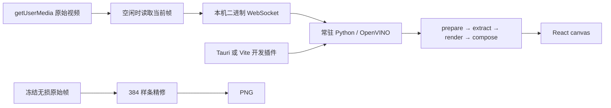

# 架构说明

## 1. 数据流

React state 只保存阶段、参数与每秒一次的统计。像素、视频和队列放在 ref 或独立控制器中。桌面摄像头通过 WebView 的 `getUserMedia` 采集，Tauri 管理 worker 与本地保存；Vite 只在开发模式提供启动 worker 的适配。

## 2. 核心算法

复用上一项目的 `prepare → extract → stylize → compose`。MobileNetV3 输出 stride 4、8、16 三层特征，计算相邻归一化特征差并形成结构响应：

$$S=0.5R_1+0.3R_2+0.2R_3,\qquad Q=E(0.25+0.75S).$$

$E$ 是共同 Sobel 边缘，$S$ 调节边缘保留强度。CNN 提供结构信息；固定色板和图像处理生成色块、线条，不是训练后的图像生成网络。

| 环节 | 实时预览 | 拍照精修 |
| --- | --- | --- |
| 输入 | 当前视频缩小后 JPEG | 拍照瞬间冻结的原始帧 PNG |
| 工作画布 | 256×256，等比例填边 | 384×384，等比例填边 |
| 色块 | 原算法 Lab 固定色板 | 同一 Lab 固定色板 |
| 线条 | NMS、滞后连接、细化，直接栅格 | 完整路径追踪、有界 B 样条、超采样 |
| 输出 | 去除填边的 JPEG | 去除填边的 PNG |

PNG 长边为 384，保持原图比例及完整画幅；并非原始相机分辨率。拍照精修重新使用冻结原帧计算，不放大旧漫画预览。原始输入尺寸记录在响应 `sourceSize` 中。

视频使用 MediaPipe VIDEO 和单调递增时间戳；五官带宽由 384 基准缩放到 256。仅对亮度增益和阈值做标量平滑，不平均连续输出图，也不挪用上一帧 $S$。未检测到人脸时，当前帧使用无几何区域的降级结果。

## 3. 通信与调度

每条帧消息为 `4 字节大端 JSON 长度 + UTF-8 JSON + JPEG/PNG`。元数据包含会话、帧号、配置版本、时间戳、宽高、旋转、格式、任务类型与镜像配置。worker 只监听 `127.0.0.1` 的随机端口，检查 Origin 和随机令牌，每次只允许一个会话。

调度器只有一个在途任务，忙时不编码新图。空闲后直接读取最新 video 帧，避免排队。会话、配置和帧号共同筛掉过时结果；暂停会使当前结果失效，拍照等待已有任务结束后处理冻结帧。前端同一单调时钟计算“采样到显示”耗时，后端单独统计解码、预处理／人脸、CNN／结构、渲染和编码。

`start_worker` 返回地址与令牌；`stop_worker(token)` 只关闭对应 worker，防止迟到的旧会话清理误伤新会话。`save_png` 检查 PNG 头、大小与文件名后写入 Downloads。连续帧不落盘；只有明确保存才写结果。

## 4. 移动端边界

响应式 React 已可在手机宽度显示，但没有 APK 和 CameraX/JNI 实现。`native/openvino/probe.cpp` 是跨平台 C++ 单图运行时验证工具，已在 Windows 上核对三层输出；这只验证了原生接口与模型契约。

后续顺序是 ARM64 OpenVINO 运行库 → 手机上的单图探针 → S/Q 与栅格渲染移植 → CameraX → Tauri mobile plugin。按推荐路线，在真实手机运行时闸口通过前不伪造“手机本地推理已完成”的状态，也不将手机调用电脑服务当作本地运行。
