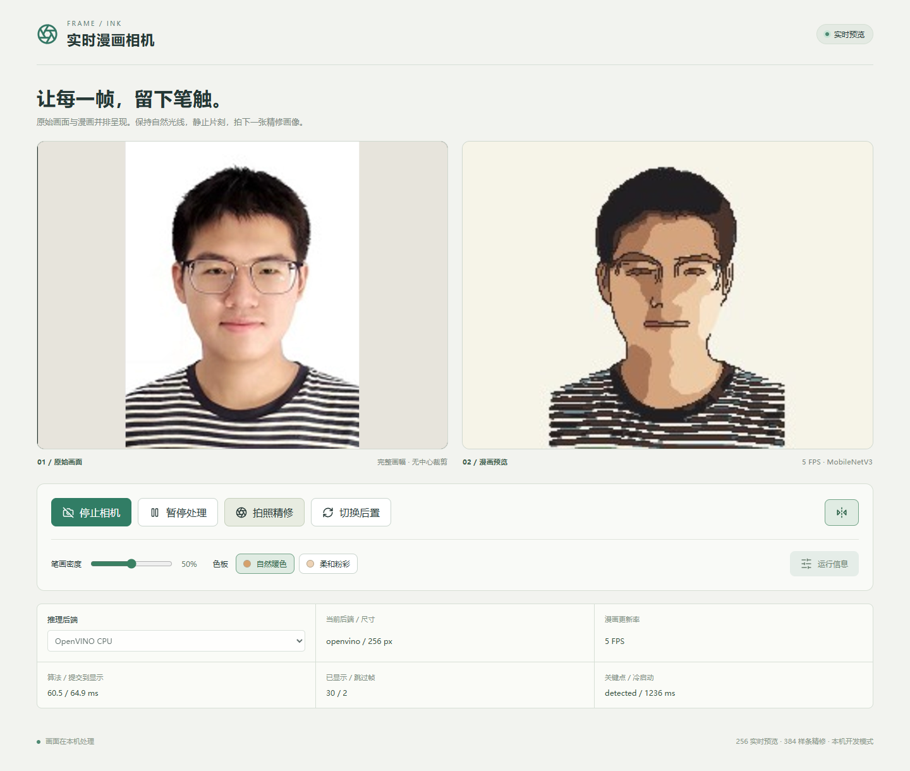
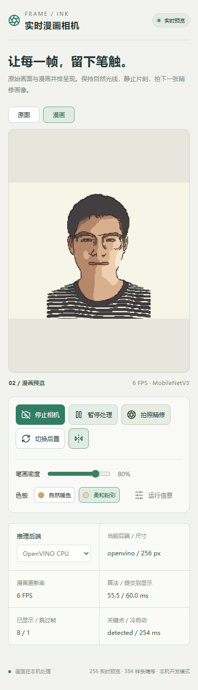

# 验证记录

日期：2026-10-30。以下是当前 Windows 环境的工程检查，不是手机性能测评或人工质量评分。

## 已核对内容

| 检查 | 结果与范围 |
| --- | --- |
| Python 类型检查 | d2l 环境 `ty check` 通过 |
| TypeScript / Vite | 生产前端构建通过 |
| 调度与生命周期 | 单帧在途、旧配置／旧会话丢弃、暂停恢复、初始化中关闭的测试通过 |
| Python worker | 真实二进制 WebSocket、PyTorch/OpenVINO 同图预览对照通过；像素容差 2/255 |
| 拍照精修 | 无损原帧输入，384 画布，完整样条渲染与 PNG 编码通过 |
| 原生探针 | C++ 在 Windows 编译运行；256／384 的三层输出与 Python OpenVINO 逐值一致 |
| 浏览器集成 | 模拟摄像头 → 人脸检测 → OpenVINO → 漫画显示、参数调整、暂停恢复、拍照下载、停止重启通过 |
| 手机宽度布局 | 390 px 视口无水平溢出；仅为响应式界面检查 |
| Rust / Tauri | Cargo 检查和 Windows 调试 EXE 构建通过 |
| 桌面人工验收 | 用户已确认电脑端验收通过 |
| Android 模型导出 | 256/384 的三层 ONNX 输出与 PyTorch 对照通过；最大绝对差 9.35×10⁻⁵，容差 rtol=2×10⁻³、atol=2×10⁻⁴ |
| Android 算法单测 | 3 项 Kotlin/JUnit 测试通过：与 PyTorch 固定样本的特征差核对、有效区域归一化、细化连通性与幂等性 |
| Android 生命周期与兼容性 | 初始化中停止会释放匹配会话；覆盖 randomUUID 缺失和无 Web Crypto 的会话编号回退，前端 7 项测试全部通过 |
| Android APK | ARM64 调试签名打包成功；APK v2 签名、ZIP 完整性、3 个模型/配置文件逐字节一致、6 个原生库与 16 KB 对齐检查通过 |

浏览器测试使用上一项目示例照片生成的静态模拟视频，**没有使用真实摄像头**。测试脚本为 `tests/browser_smoke.py`，需要可选依赖 Playwright 和已启动的 Vite；通过后会把日志、PNG 与截图放到 `.cache/qa/`。没有自动化页面错误。

## 性能快照

最后一轮模拟相机测试：OpenVINO CPU、256 预览，约 5 FPS；最近一帧算法约 60.5 ms，采样到显示约 64.9 ms；模型会话初始化约 1236 ms。初始化统计不含启动 Python 和导入库的时间。界面 FPS 统计实际显示的漫画帧；采样有约 10 FPS 上限，模拟源本身也限制了帧率。

原生 C++ 20 次预热后 CNN 推理均值：256 约 1.68 ms，384 约 3.48 ms。这里只计 CNN，不含图像预处理、人脸、结构响应、渲染、编解码或传输，因此不能据此推算整条相机链路 FPS。

这些数值是一次本机检查的快照，不是稳定性或不同设备性能保证。没有进行数分钟真机温度、内存与持续运行测试。

## 界面截图

桌面浏览器使用示例照片的模拟视频流：

390 px 响应式布局，同一台 Windows 电脑上的浏览器：

## Android 安装包

文件：`dist-android/CartoonCamera-arm64-debug.apk`，版本 0.1.1（versionCode 1001），98,769,297 字节（约 94.2 MiB）；Android 10/API 29 起，目标 API 36，只有 arm64-v8a。SHA-256：`cec0dec034b591a5df553f15e5cbc814ac03ec3cfbb77279894fab9c91e4a307`。

0.1.0 的手机反馈为 `crypto.randomUUID is not a function`，对应模型初始化前的会话编号生成。0.1.1 改为检测 API：可用时使用原生 UUID，否则由 `getRandomValues` 生成 UUID；两者均不可用时使用页面时间前缀与递增序号。该编号只用于区分相机会话及过滤过期帧，不是鉴权令牌。[Web Crypto 规范](https://w3c.github.io/webcrypto/#Crypto-interface)对 randomUUID 标记了安全上下文要求；尚未确定该手机是 WebView 版本还是页面环境导致接口不可用。

修复版通过 TypeScript/Vite 构建、7 项前端测试、Python 类型检查、APK 签名和资源检查。签名证书与 0.1.0 相同，可覆盖安装；仍待用户手机验证。

使用 ONNX Runtime Android 1.23.2、OpenCV 4.12.0、MediaPipe 0.10.26。导出数值对照在 Windows PyTorch/ONNX Runtime 1.31.1 上执行；它核对导出模型，不代表 Android 运行时已经逐值验证。Kotlin 单测在宿主 JVM 上执行，不包含相机和 Android 原生推理。

构建环境：JDK 21.0.8、Gradle 9.6.1、Android Gradle Plugin 9.3.1、SDK/Build Tools 36、NDK r28c。首次下载曾遇到 Java 代理证书和 Maven TLS 握手问题，已使用 Windows 根证书库与 Maven Central 官方 repo1 端点解决。无需 adb 即可构建与手动安装，详见 [Android 打包与安装](../native/android/README.md)。

检查脚本 `scripts/verify_apk.py` 生成 `dist-android/payload-verification.json`；构建脚本生成 `SHA256SUMS.txt`。模型、APK 和构建目录不纳入 Git。

## 尚未验证

- Windows WebView2 的自动化调试端口未能建立连接；桌面端已由用户验收，自动化记录仍以浏览器测试为主。
- Windows EXE 依赖当前仓库、上一项目模型和 Conda d2l，尚未制作独立 Windows 发行安装包。
- 没有连接真实 Android 手机；手机摄像头权限、CNN 运行、参数调整、拍照相册保存、温度、内存与实际 FPS 仍待安装验收。
- Android 当前使用 WebView 相机和 ONNX Runtime CPU；CameraX、ARM64 OpenVINO 与手机样条精修尚未实现。

APK 构建、签名和模型检查均不能替代上述真机验收。
