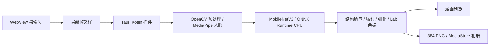

# Android 打包与安装

## 安装方式

面向 **ARM64、Android 10 及以上**的手机。构建不需要手机、USB 调试或 adb；adb 仅用于可选的连接安装和日志诊断。

构建脚本把调试签名 APK 复制到 `dist-android/CartoonCamera-arm64-debug.apk`。传到手机，在文件管理器中打开并允许该来源安装。首次启动允许摄像头权限；开始后等待模型预热。拍照后“保存 PNG”写入相册 `Pictures/CartoonCamera`。

APK 包含前端、MobileNetV3、MediaPipe 模型及原生推理库，无需 Python、电脑服务或联网下载模型。调试签名用于课程安装测试，尚未配置应用商店发行签名。

## 本机编译

已准备 JDK 21.0.8、Android SDK 36、Build Tools 36.0.0、NDK 28.2.13676358、Rust aarch64-linux-android。位置写在 `scripts/android-env.ps1`，只设置当前终端的环境变量。

```powershell
conda activate d2l
Set-Location 'B:/LearnSpace/Course Notes/projects/realtime_cartoon_camera'
# 模型已有时不必重复导出。
python python/export_android.py
powershell -ExecutionPolicy Bypass -File scripts/build-android.ps1 -UseProxy
```

`-UseProxy` 使用本机 127.0.0.1:7897 代理、Windows 系统证书库和 TLS 1.2。没有该代理时去掉参数。首次编译需要下载 Gradle/Maven 依赖。Java 的 PKIX 证书错误通过 Windows 根证书信任解决，不必关闭 TLS 校验。Maven Central 使用官方 repo1.maven.org 端点。

`tauri android build --debug --apk --target aarch64` 打包生产前端资源，即使是调试签名，也不依赖 Vite 开发服务器。更换电脑需调整 SDK/JDK 路径；不要重新初始化覆盖已有 Manifest、minSdk 和依赖配置。

可选的 adb 安装：

```powershell
Set-ExecutionPolicy -Scope Process Bypass
. ./scripts/android-env.ps1
adb devices
adb install -r dist-android/CartoonCamera-arm64-debug.apk
```

## 手机实现



- 使用上阶段冻结权重、三层特征及输入均值/方差，导出动态空间尺寸 ONNX。导出脚本分别在 256/384 核对三层输出与 PyTorch。
- Kotlin 移植单位化特征差、分位数归一化、S=0.5R1+0.3R2+0.2R3、Q=E(0.25+0.75S)、区域阈值、连通筛选、细化与固定色板。这是 CNN 结构引导的图像处理方法。
- MediaPipe 使用 VIDEO 模式和递增时间戳，每帧重新计算 CNN 响应；只平滑亮度增益和阈值。无人脸时使用当前帧无几何区域的结果。
- 相机沿用 getUserMedia，Tauri WebChromeClient 负责 Android 摄像头权限；此版没有 CameraX。桥接传递压缩 JPEG/PNG 的 Base64，只有一帧在途，过期会话/配置结果不显示。
- 原生单线程串行访问模型，停止和 Activity 销毁释放资源。相册使用 MediaStore，不申请全盘存储权限。
- 手机 384 拍照重新计算冻结原帧，仍用栅格线条；桌面的 SciPy 样条精修没有移植。两平台可能因取整、细化与推理精度略有不同。

## 路线调整

推荐路线中的 ARM64 OpenVINO 需要针对 Android 源码构建运行库。本次先采用提供 Android 原生包的 ONNX Runtime CPU，复用相同 CNN 权重和结构引导方法。桌面仍用 OpenVINO；native/openvino 探针保留，后续可替换手机推理后端。

## 验证边界

模型对照、Kotlin 数值核对、APK 构建与内容检查见 [验证记录](../../docs/验证记录.md)。当前没有连接真实手机，摄像头授权、具体机型兼容性、相册保存、持续运行和手机 FPS 需要安装后确认；电脑结果不能当作手机性能。

安装后检查：相机授权 → 模型预热 → 漫画更新 → 密度/色板调整 → 拍照保存 → 停止重启。若报错，界面显示错误信息；进一步诊断时再使用 adb 日志。
